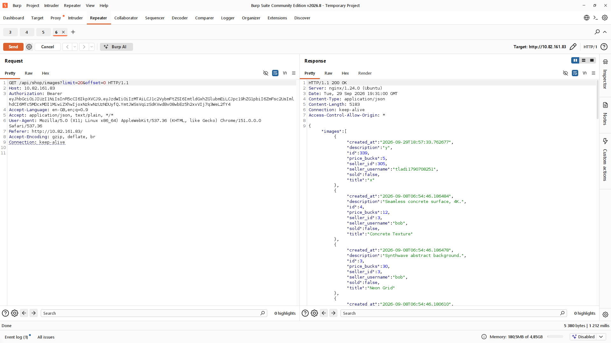

[← Back to overview](../README.md)

# Finding 1: Cleartext Transport (No TLS)

**Severity:** Medium
**CWE:** CWE-319
**OWASP Top 10 (2021):** A02:2021

## Description

The entire application is served over plain HTTP with no TLS encryption anywhere. Every piece of traffic, including authentication tokens, session cookies, and the payment card fields submitted during a voucher purchase, travels across the network completely unencrypted, and no `Strict-Transport-Security` header is present to encourage a client to prefer an encrypted connection even if one existed. This is **CWE-319 (Cleartext Transmission of Sensitive Information)**, under **OWASP A02:2021-Cryptographic Failures**.

As part of the same review, the cookie flags issued on admin login were also checked: the session cookie is correctly marked `HttpOnly`, but neither admin cookie carries the `Secure` flag. On plain HTTP this has no additional practical effect today, since there is no encrypted connection to be excluded from, but it means that even once TLS is eventually added, those cookies would still be sent over an accidental HTTP connection unless the `Secure` flag is also set at the same time, which is why this is recorded here as an addendum rather than as its own separate finding.

## Reproduction Steps

1. Open the application in the browser and look at the address bar. It reads `http://` rather than `https://`, and the browser marks the connection "Not secure" directly next to the address.

2. Attempt to browse directly to the target over HTTPS instead. The connection fails outright, confirming no HTTPS listener is present at all, not merely that a redirect to it was overlooked.

3. Inspect a voucher purchase request sent over plain HTTP and observe the card number, expiry date, and CVV fields are all visible in plain text, exactly as an eavesdropper on the network would see them. Chrome itself additionally refuses to auto-fill the payment fields on this form for the same reason, warning that "automatic payment methods filling is disabled because this form does not use a secure connection," a further, independent confirmation from the browser's own security engine.

## Evidence

*__Figure 1.1__ - SS F16 01 not secure address bar and headers.*

## Business Impact

This finding scores High on Confidentiality: anyone positioned to observe the network path between a user and the server, for example on a shared public Wi-Fi network, a compromised router along the path, or through local network spoofing, can capture credentials, authentication tokens, session cookies, and full payment card details submitted during checkout, and can also tamper with responses in transit, since there is no integrity protection over the connection either. This is a foundational gap that undermines the confidentiality guarantees every other finding in this report implicitly assumes hold true; even a perfectly implemented authentication scheme offers no real protection if the credentials it relies on are transmitted in the clear for anyone on the network to capture.

## Remediation

Serve the application over HTTPS exclusively, using a certificate from a trusted certificate authority, redirect all plain HTTP traffic to HTTPS at the network edge, and set a `Strict-Transport-Security` header with a long `max-age` and `includeSubDomains`. Mark all session and CSRF cookies `Secure` at the same time this is done, so the fix is complete rather than leaving the cookie-flag gap noted above unresolved.
