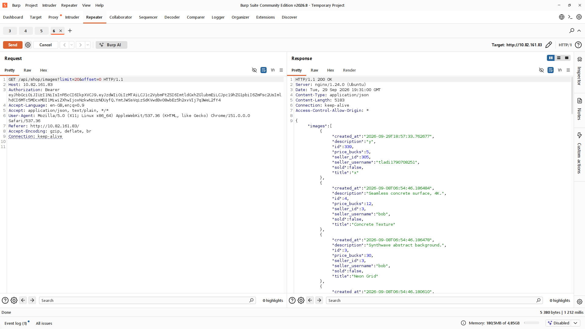

[← Back to overview](../README.md)

# Finding 2: Information Disclosure (Server Version Banner)

**Severity:** Informational
**CWE:** CWE-200
**OWASP Top 10 (2021):** A05:2021

## Description

Every response from the server discloses the exact web server software and version in use through its `Server` header, information an attacker would otherwise have to work harder to fingerprint. This is **CWE-200 (Exposure of Sensitive Information to an Unauthorized Actor)**, under **OWASP A05:2021-Security Misconfiguration**. A wide range of deliberately malformed input was also tried against multiple endpoints specifically to check for a stack trace or a more verbose server error appearing alongside this banner; the application handled every one of those cases cleanly, with a specific `400` response and a descriptive message rather than any internal detail leaking out, so this finding is limited to the version banner itself rather than a broader verbose-error disclosure.

## Reproduction Steps

1. Inspect the response headers of any request at all; every single one reveals `nginx/1.24.0` running on Ubuntu.

2. Send a range of deliberately malformed request bodies, wrong data types, invalid JSON syntax, and deeply nested structures, to several different endpoints in turn. Each one returns a clean, specific error rather than a stack trace or any other internal detail, ruling out a more serious disclosure existing alongside the version banner.

## Evidence

*__Figure 2.1__ - SS F24 01 nginx version disclosed.*

## Business Impact

This finding scores Informational, since it cannot be exploited directly on its own, but version and platform disclosure of this kind helps an attacker match known, published vulnerabilities to the specific target and refine their approach without needing to spend time fingerprinting the underlying stack through slower, noisier means. On its own this is a minor finding, but it compounds in severity alongside any future, currently unknown vulnerability specific to the particular nginx version this instance discloses.

## Remediation

Suppress or genericise the server version banner, for example nginx's `server_tokens off;` directive, along with the equivalent setting for any other component in the stack that similarly discloses its own version. The input validation behaviour observed during this testing was already handled well and needs no change.
