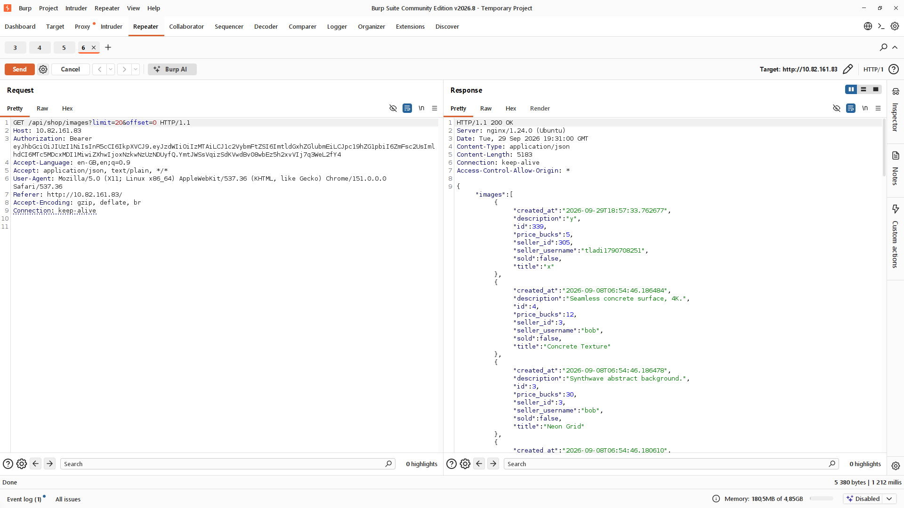

[← Back to overview](../README.md)

# Finding 3: Missing Clickjacking Protection

**Severity:** Low
**CWE:** CWE-1021
**OWASP Top 10 (2021):** A05:2021

## Description

No response from the application, including the administrator login page itself, sets any header that would prevent the page from being loaded inside a frame on a third-party website. This is **CWE-1021 (Improper Restriction of Rendered UI Layers or Frames)**, under **OWASP A05:2021-Security Misconfiguration**.

## Reproduction Steps

1. Inspect the response headers returned by the main application and separately by the admin login page; neither sets `X-Frame-Options` nor a `Content-Security-Policy` containing `frame-ancestors`.

2. Embed the admin login page inside an HTML frame on a locally hosted test page. It renders with no blocking of any kind, confirming the page can genuinely be embedded by a third party rather than this being only a theoretical header omission.

## Evidence

*__Figure 3.1__ - SS F21 01 no x frame options header.*

## Business Impact

This finding scores Low on Integrity: what was demonstrated is that the application permits third-party framing, confirmed against the admin login page. A full clickjacking attack against an already-authenticated administrator session was not demonstrated, and Finding 25 establishes that the admin session cookies are `SameSite=Lax`, which would likely also restrict whether an authenticated admin page remains usable when loaded inside a cross-site frame, narrowing the practical exploitability of this finding today in the same way it narrows Finding 25's.

The missing header is still a genuine gap worth closing as defence in depth: it removes a protection the application should have regardless of what other controls happen to also be in place, and would matter more immediately if the `SameSite` protection were ever relaxed for an unrelated reason.

## Remediation

Set a `Content-Security-Policy` header with `frame-ancestors 'none'` on every response, and add `X-Frame-Options: DENY` alongside it for older browsers that do not honour the CSP header, with particular priority given to the administrative area given the higher-value actions available there compared with the rest of the site.
