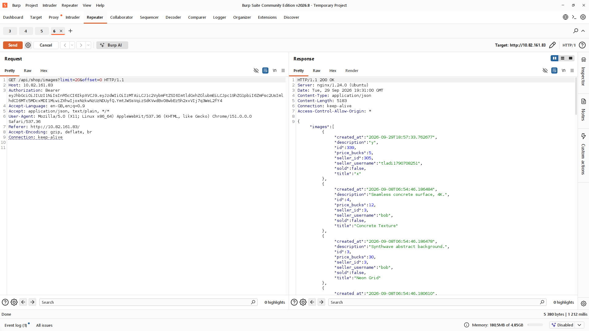

[← Back to overview](../README.md)

# Finding 4: Permissive Cross-Origin Resource Sharing

**Severity:** Low
**CWE:** CWE-942
**OWASP Top 10 (2021):** A05:2021

## Description

The API reflects whatever value is sent in the request's `Origin` header straight back in the `Access-Control-Allow-Origin` response header, rather than checking it against any fixed list of trusted origins. This means any website on the internet can make cross-origin requests to this API directly from a victim's browser. This is **CWE-942 (Permissive Cross-domain Policy with Untrusted Domains)**, under **OWASP A05:2021-Security Misconfiguration**.

Credentials are not currently allowed alongside this reflection, since `Access-Control-Allow-Credentials` is not set, which limits the immediate practical impact today, but the reflection itself remains a genuine misconfiguration that would become serious the moment credentialed CORS is ever enabled alongside it.

## Reproduction Steps

1. Browse the listings page normally and check the response headers on the `GET /api/shop/images` request in Burp's **HTTP history**. It already carries `Access-Control-Allow-Origin: *`, a literal wildcard, without any request modification needed at all.

2. Send the same request to **Repeater**, add the header `Origin: http://evil.example.com`, and click **Send**. The response still allows it, unconditionally.

3. On a different endpoint, `POST /api/auth/login`, the same test instead reflects the exact `Origin` value sent back verbatim rather than a wildcard. Repeating that test with a second, entirely unrelated origin value is reflected back just as faithfully, confirming this is unconditional reflection of whatever origin is sent on that route, rather than an allow list that simply happened to include the value tested. Between the two behaviours, every route on the API permits cross-origin access from any website whatsoever, whether through a hardcoded wildcard or through blind reflection.

## Evidence

*__Figure 4.1__ - SS F23 01 access control allow origin wildcard.*

## Business Impact

This finding scores Low on Confidentiality today, given credentials are not currently permitted alongside the reflection, but it weakens the browser's same-origin protections for every endpoint on this API regardless, and would allow full cross-origin reading of authenticated user data from a victim's own browser the moment credentialed CORS is enabled alongside it, which is a common and easy misconfiguration to introduce later, for example when a legitimate partner integration is added, without anyone realising the origin reflection already quietly in place removes any real restriction that integration was meant to be scoped by.

## Remediation

Do not reflect the `Origin` header under any circumstance. Serve `Access-Control-Allow-Origin` only for an explicit, server-side allow list of genuinely trusted origins, and never combine origin reflection, or a wildcard value, with `Access-Control-Allow-Credentials: true` at any point in the future.
