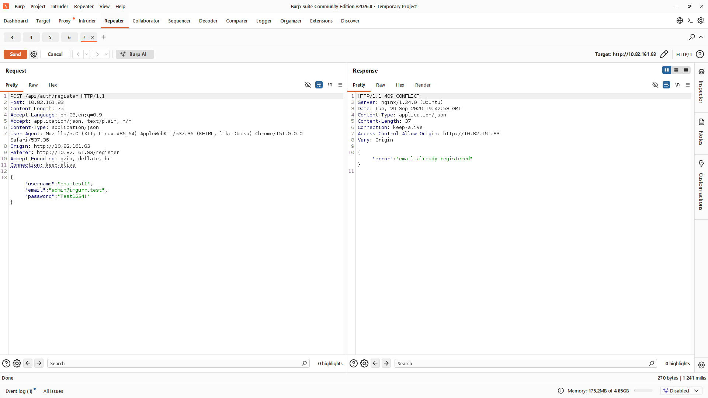
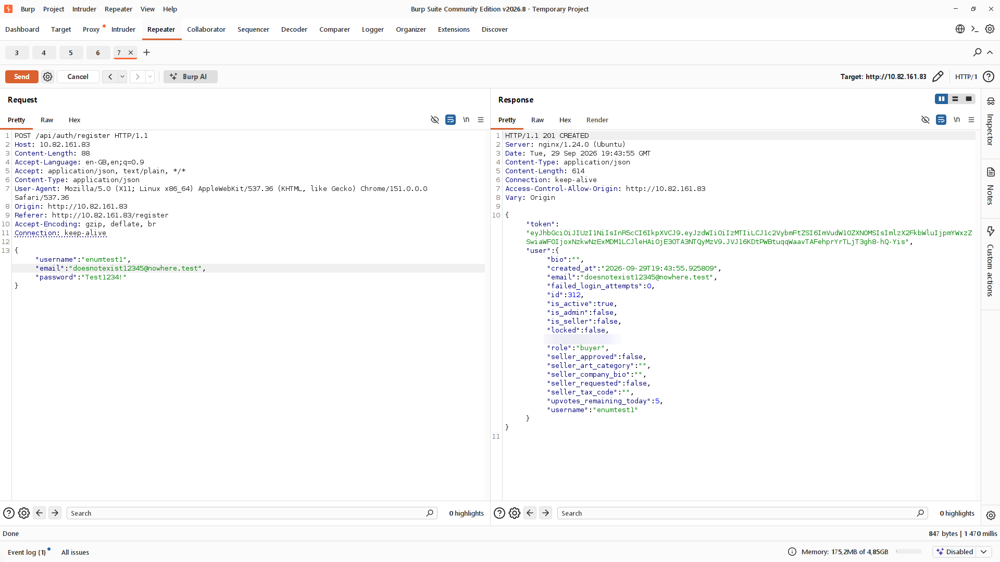

[← Back to overview](../README.md)

# Finding 5: User Enumeration via Registration

**Severity:** Low
**CWE:** CWE-203
**OWASP Top 10 (2021):** A07:2021

## Description

Attempting to register a new account returns a distinct, specific error message depending on whether it was the username or the email address that was already taken, rather than a single generic error covering both cases. This lets an attacker confirm precisely which accounts exist on the platform without ever needing to log in. The endpoint is `POST /api/auth/register`. This is **CWE-203 (Observable Discrepancy)**, under **OWASP A07:2021-Identification and Authentication Failures**.

## Reproduction Steps

1. On the **Register** page, fill in a throwaway username, the known, already-registered address `admin@imgurr.test` as the email, and any password, then submit. In Burp's **HTTP history**, find the resulting `POST /api/auth/register` request for reference.

2. The response is `409 CONFLICT` with the body `{"error":"email already registered"}`, confirming the address exists without ever needing to log in as it.

3. Right-click that same request and choose **Send to Repeater**. In the Repeater copy, change only the `email` field to a genuinely fresh, never-used address, keep the same username and password, and click **Send**.

4. This time the response is `201 CREATED`, returning a full token and user object exactly as a normal successful registration would. The contrast between the two responses, a specific conflict error against a JSON body carrying a working session token, is a clean, unambiguous signal that reveals whether any given email address is already registered.

5. Attempting a known, already-taken username together with a fresh email produces a third, separately worded message, "username already taken," confirming the endpoint discloses which specific field collided rather than returning one generic error for both cases.

## Evidence

*__Figure 5.1__ - SS F19 01 existing email 409 conflict.*

*__Figure 5.2__ - SS F19 02 new email 201 created.*

## Business Impact

This finding scores Low on Confidentiality: valid accounts can be enumerated one guess at a time, with no rate limiting observed on this route during testing, which supports targeted phishing by confirming a specific person's email is genuinely registered on the platform before a tailored lure is sent to them, and supports credential-stuffing attacks by filtering a large leaked credential list down to only the entries confirmed valid on this specific platform before any login attempts are made, which meaningfully improves an attacker's success rate per attempt made against the login endpoint itself.

## Remediation

Return a single, generic response for registration regardless of whether the account already exists, for example always responding as though registration succeeded and confirming account creation out of band by email, while only actually creating the account if it does not already exist, so that an attacker learns nothing at all from the content of the response itself.
