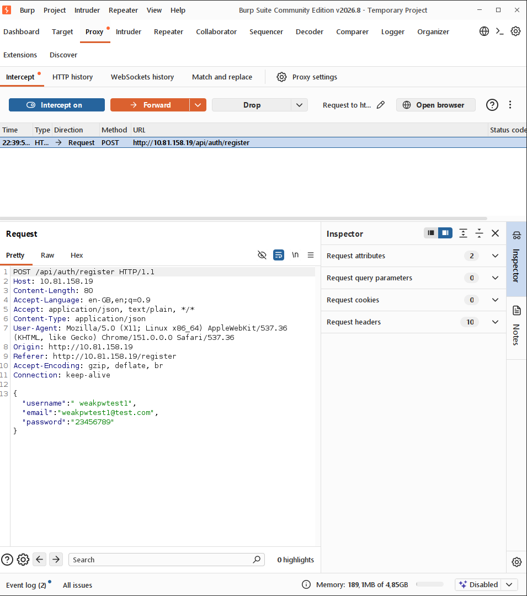

[← Back to overview](../README.md)

# Finding 6: Weak Password Policy

**Severity:** Low
**CWE:** CWE-521
**OWASP Top 10 (2021):** A07:2021

## Description

The application enforces a length requirement at registration (8 to 128 characters, rejected server-side with `"password must be between 8 and 128 characters"` outside that range) but no complexity requirement whatsoever beyond that length check: a password consisting entirely of eight sequential digits (`23456789`), with no uppercase, lowercase, symbol, or dictionary-word restriction of any kind, is accepted without complaint. This is **CWE-521 (Weak Password Requirements)**, under **OWASP A07:2021-Identification and Authentication Failures**.

This finding is distinct from, though thematically related to, Findings 3 and 7. The administrator's own password and the JWT signing secret being both the single word "password" is not caused by this registration-form weakness; a registration password policy governs what an end user is allowed to type in, it has no bearing on an operational secret like a JWT signing key or an administrator credential that a developer or operator sets independently. What the two issues share is a platform-wide pattern of not enforcing credential strength anywhere, on end-user passwords or on operational secrets, rather than one being the technical cause of the other.

## Reproduction Steps

1. Attempt to register a new account using a password under 8 characters. The server correctly rejects this with a `400` and an explicit length-requirement error message, confirming a minimum length IS enforced.

2. Register a new account using an 8-character password with zero complexity, such as `23456789` (sequential digits only, no letters or symbols). The account is created successfully with no rejection, confirming the only requirement enforced is length, not composition.

## Evidence

*__Figure 6.1__ - SS F22 01 weak password accepted.*

## Business Impact

This finding scores Low on Confidentiality and Integrity: an end user who is allowed to set a long-but-trivially-guessable password (sequential digits, repeated characters, or a single dictionary word padded to length) is easier to compromise through credential guessing or stuffing than one required to include basic complexity, exposing that individual account's own data and any actions it can perform. The existing length check already blocks the most trivial one- or two-character passwords, which limits this finding's severity relative to a platform with no validation at all. Fixing this endpoint's complexity validation would further improve end-user account security, but it would not, on its own, close Findings 3 or 7, which are separate operational credential-management failures on the platform's own infrastructure rather than consequences of what this registration form allows a user to type.

## Remediation

Enforce a genuine password policy where a practical minimum length is prioritised over complex composition rules, which research consistently shows users work around rather than genuinely comply with, and screen new passwords against a known-breached-password list such as the Pwned Passwords API before accepting them. Separately from end-user policy, ensure operational secrets such as the JWT signing key and the administrator's own credentials are always generated from a cryptographically secure random source and are never allowed to be dictionary words, regardless of whatever policy is applied to ordinary end-user passwords.
