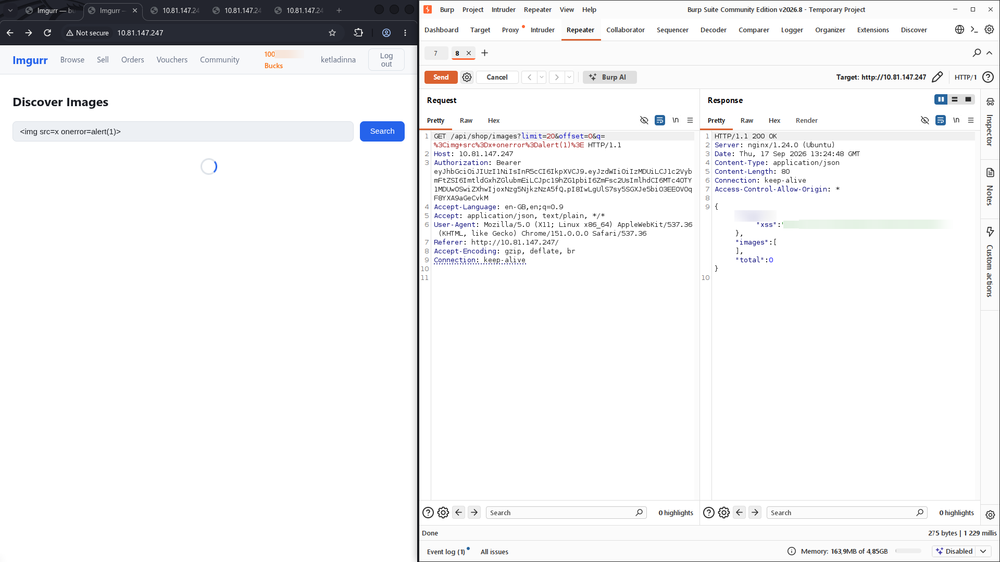
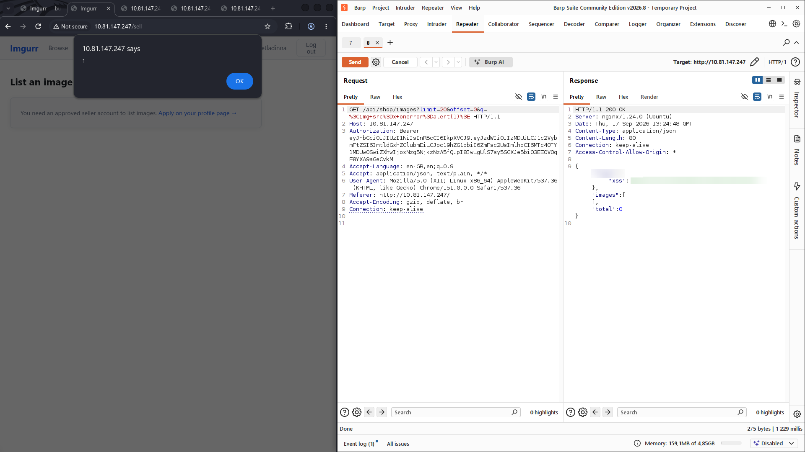

[← Back to overview](../README.md)

# Finding 7: Reflected Cross-Site Scripting (Image Search)

**Severity:** Medium
**CWE:** CWE-79
**OWASP Top 10 (2021):** A03:2021

## Description

The image search functionality reflects the supplied search term back into the application's response without sufficient output encoding. As a result, attacker-controlled input can be interpreted as executable script when the search results are rendered in a user's browser, rather than being displayed as plain text.

The affected endpoint is `GET /api/shop/images?q=`. Unlike the stored XSS identified in Finding 10, the payload is not permanently stored by the application and must be delivered to the victim as part of a crafted search request or URL. The application's own confirmation marker was observed during testing, confirming that the reflected input can be executed in the application's browser context.

This is **CWE-79 (Improper Neutralization of Input During Web Page Generation)** and is classified under **OWASP A03:2021-Injection**. Although both findings involve XSS, they represent separate vulnerabilities because the payloads reach victims through different application flows and require different exploitation conditions.

## Reproduction Steps

1. Enable **Proxy → Intercept → Intercept is on** in Burp Suite. Search for a harmless term using the application's normal image search functionality. The legitimate request to `GET /api/shop/images?q=` is intercepted.

2. Replace the `q` parameter with the reflected XSS test payload used during the assessment:

```
      <svg onload=alert(1)>
```

URL-encode the payload using **Ctrl+U** in the Burp editor, then forward the request.

3. Review the response and confirm that the application returns its confirmation marker. Open the same search URL directly in a browser and observe the JavaScript alert executing when the search results render. This confirms that the input reaches an executable browser context rather than being safely encoded as text.

4. Test alternative payload structures to assess the application's filtering behaviour. During the assessment, `<svg onload=...>`, `<body onload=...>`, and `` payloads executed, while an `<iframe>` using a `javascript:` URI did not. This indicates that the application applies some filtering to user-supplied input, but the filtering does not reliably prevent executable HTML and JavaScript from reaching the rendering context.

## Evidence


*__Figure 7.1__ - SS XSSReflected 01 search request.*


*__Figure 7.2__ - SS XSSReflected 02 alert popup.*

## Business Impact

This finding presents a High risk to Confidentiality and Integrity because the application's session authentication token is stored in `localStorage`, where JavaScript executing in the application's origin can access it. Successful exploitation could therefore allow an attacker to obtain a victim's authentication token and make authenticated requests as that user.

The finding is rated Medium overall because exploitation requires the victim to access a specifically crafted search URL. Unlike the stored XSS identified in Finding 10, the payload is not triggered simply by browsing normal site content. This additional delivery requirement reduces the likelihood of opportunistic exploitation, although it still provides a practical avenue for targeted attacks through malicious links.

A successful attack could result in unauthorised access to functionality and information available to the affected account. If the victim has elevated privileges, the potential impact would be correspondingly greater. The incident could result in customer or user data exposure, unauthorised actions, incident response and recovery costs, and reputational damage. Where personal information is accessed without authorisation, the organisation may also have notification obligations under **POPIA Section 22**.


## Remediation

Encode all reflected user-supplied values according to the output context in which they are rendered. For values placed in HTML text nodes, apply appropriate HTML entity encoding. Where values are inserted into HTML attributes, JavaScript, URLs, or other contexts, use the corresponding context-specific encoding rather than relying on a single generic sanitisation method.

Apply the same restrictive **Content Security Policy (CSP)** recommended under Finding 10 as an additional defence-in-depth control. CSP should not replace proper output encoding, but it can prevent or limit script execution if an encoding error is introduced elsewhere.

The rendering pipeline for Finding 10 and the output handling for `GET /api/shop/images?q=` should be remediated under a single, platform-wide output-encoding standard. This reduces the likelihood of similar XSS vulnerabilities being introduced through other rendering sinks and provides a consistent approach to handling user-controlled data throughout the application.
