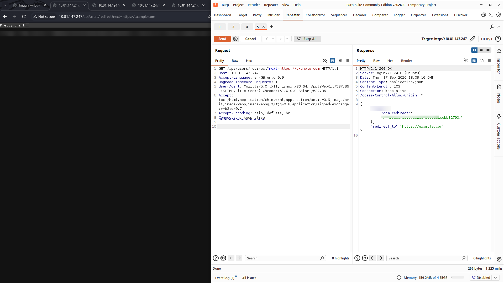

[← Back to overview](../README.md)

# Finding 8: Open Redirect and DOM-Based XSS via Unsafe Navigation

**Severity:** Medium
**CWE:** CWE-601
**OWASP Top 10 (2021):** A01:2021

## Description

A utility endpoint intended to redirect a user onward after some action instead reflects whatever destination is supplied, with no check that the destination stays on the platform's own domain. The front end takes that value and assigns it directly to the browser's own location, which means it drives both a conventional open redirect and a separate, DOM-based redirect sink, since the destination reaches the browser's navigation directly rather than through a server-side redirect the browser itself performs. The endpoint is `GET /api/users/redirect?next=`, and no authentication is required to reach it; it responds identically with no `Authorization` header sent.

This is **CWE-601 (URL Redirection to Untrusted Site)**, classified under **OWASP A01:2021-Broken Access Control** in the 2021 edition of that list, which folded open redirect into the broader access-control category.

## Reproduction Steps

1. Build `GET /api/users/redirect?next=https://evil.example.com` directly in Repeater, without authentication. Click **Send**.

2. The response reflects the destination and returns the injected destination. Opening the equivalent URL directly in a browser with `next=javascript:alert(1)` fires an alert, confirming the front end genuinely assigns this value to the browser's own `window.location`, and that the DOM sink is exploitable in a real browser, not merely observable as a value inside a raw HTTP response.

## Evidence

*__Figure 8.1__ - SS DomRedirect 01 open redirect.*

## Business Impact

An open redirect through a link that visibly points at the legitimate imgurr domain, right up until the final hop, lends real credibility to a phishing attempt and materially increases how often a victim clicks it compared with a link to an obviously unrelated domain; it can also defeat email and URL-reputation filters that only inspect the first-party host of a link rather than following it through. The DOM-based sink adds a further, more severe consequence beyond redirection alone: a crafted `javascript:` payload executes directly in the visiting user's own session the moment the link is followed, which carries the same token-theft consequences described under Finding 10, again amplified by the fact that the session token sits in unprotected browser storage.

## Remediation

Do not redirect to a user-supplied absolute URL under any circumstance. Allow only relative paths, or a fixed server-side allow list of known, legitimate destinations, and never pass untrusted input into `window.location` or any other DOM navigation sink without first validating it against that same allow list.
