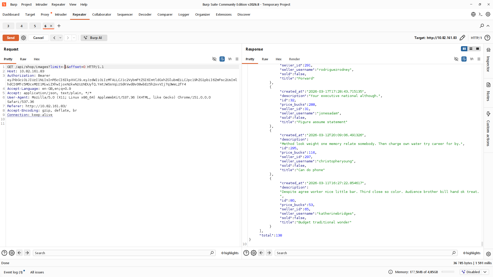

[← Back to overview](../README.md)

# Finding 9: Pagination Limit Bypass

**Severity:** Low
**CWE:** CWE-770, CWE-20
**OWASP Top 10 (2021):** A04:2021

## Description

The main image listings endpoint caps how many results it returns per request under normal use, but supplying a negative value for the limit parameter bypasses that cap entirely and returns the whole catalogue in a single response. The endpoint is `GET /api/shop/images`. This is **CWE-770 (Allocation of Resources Without Limits or Throttling)** arising from **CWE-20 (Improper Input Validation)** on the limit parameter specifically, under **OWASP A04:2021-Insecure Design**.

## Reproduction Steps

1. Browse the listings page once in the application so the genuine `GET /api/shop/images?limit=20&offset=0` request appears in Burp's **HTTP history**. Right-click it and choose **Send to Repeater**.

2. In the Repeater request, change `limit=20` to `limit=-1`, leaving `offset=0` untouched, and click **Send**.

3. Scroll to the bottom of the response body. The `"total"` field still reads 138, but the `"images"` array itself now runs to every single record in the catalogue rather than the twenty a positive limit value returns, and the response size grows from under 200 bytes for a single-record request to over 36,000 bytes.

## Evidence

*__Figure 9.1__ - SS F18 01 limit negative one returns all 138.*

## Business Impact

This finding scores Low on Confidentiality and Availability: it lets the entire public catalogue be scraped in one request rather than through the many paginated requests the interface was designed around, which increases the server load generated by a single attacker request and removes whatever natural rate-limiting effect legitimate pagination would otherwise have provided. Were an endpoint of this kind ever extended to expose more sensitive fields than a public product listing does today, this same pattern would directly widen the scope of any future mass-disclosure incident.

## Remediation

Validate the limit parameter as a positive integer within a clearly defined maximum bound on the server, and clamp or reject any out-of-range value rather than passing it through unchecked to the underlying database query.
