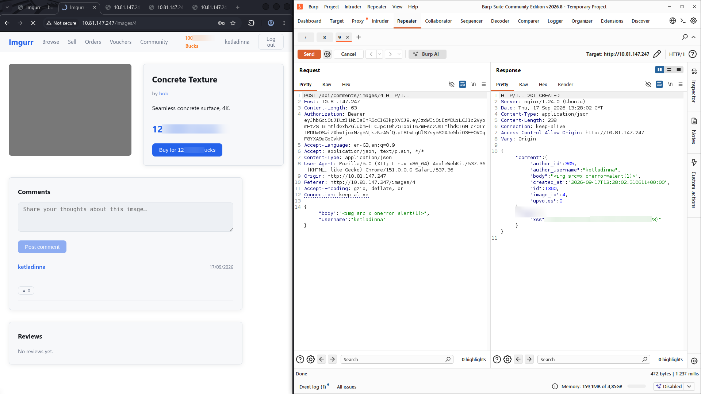
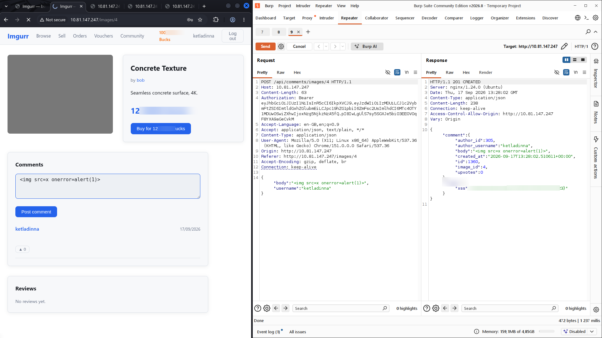

[← Back to overview](../README.md)

# Finding 10: Stored Cross-Site Scripting (Comments)

**Severity:** High
**CWE:** CWE-79
**OWASP Top 10 (2021):** A03:2021

## Description

Comments submitted on an image listing are stored without sufficient output encoding and are later rendered to other users who view the image or browse the site-wide leaderboard of most-upvoted comments. Because the comment content is rendered using `innerHTML`, an attacker can submit HTML containing executable JavaScript. The script then executes in the browser of any user who views the affected comment, including an administrator reviewing user-generated content.

The vulnerable functionality is exposed through `POST /api/comments/images/<id>`. The submitted comment is rendered using `innerHTML` on both the individual image page and the Community leaderboard, providing two separate locations where a stored payload can be triggered.

This is **CWE-79 (Improper Neutralization of Input During Web Page Generation)** and is classified under **OWASP A03:2021-Injection**.

## Reproduction Steps

1. **Enable Proxy → Intercept → Intercept is on in Burp Suite. Submit a comment on an image using the normal comment form. The legitimate `POST /api/comments/images/<id>` request is intercepted.**

2. **Modify the `body` field of the intercepted JSON request to the stored XSS test payload used during the assessment:**

```
****
```

**Forward the request and confirm that the application accepts and stores the comment.**

3. **Open Proxy → HTTP history and review the forwarded request and response. The response confirms that the submitted comment was processed successfully.**

4. **Open the affected image page in a browser. When the stored comment is rendered, the injected `onerror` handler executes automatically, demonstrating that the payload is being interpreted as HTML and JavaScript rather than displayed as inert text.**

5. **Review the application's browser storage using the browser's developer tools. The application's own origin contains a `token` entry in `localStorage` containing the session authentication token. Because `localStorage` is accessible to JavaScript running in the application's origin, a malicious stored XSS payload could access this token and transmit it to an attacker-controlled server when a user views the affected comment.**

**This confirms that the vulnerability is persistent stored XSS and that its potential impact extends beyond execution of arbitrary JavaScript in the victim's browser to compromise of authentication tokens stored in the application's `localStorage`.**


## Evidence


*__Figure 10.1__ - SS XSSStored 01 comment request.*


*__Figure 10.2__ - SS XSSStored 02 comment textarea.*

## Business Impact

This finding presents a High risk to both Confidentiality and Integrity. The application's session authentication token is stored in `localStorage`, which is accessible to JavaScript executing in the application's origin. A successful stored XSS attack could therefore allow an attacker to read a victim's authentication token and use it to make authenticated requests as that user.

This creates a practical account-compromise risk rather than limiting the impact to page modification or phishing. If the affected user has elevated privileges, such as an administrator, the consequences could extend to the administrative functionality available to that account.

The payload is rendered on both the individual image page and the site-wide Community leaderboard. This increases the number of locations where a stored payload can be triggered and increases the likelihood of exposure to users who routinely browse user-generated content, including administrators or moderators.

Successful exploitation could therefore result in unauthorised access to user accounts, exposure or modification of information available to those accounts, further abuse of privileged functionality, incident response and recovery costs, and reputational damage. Where personal information is accessed without authorisation, the incident may also create notification obligations under **POPIA Section 22**.


## Remediation

Render user-submitted comments as text rather than executable HTML. Use a text-only method such as `textContent` instead of `innerHTML` when inserting comment content into the page. Where HTML formatting is genuinely required, apply context-appropriate output encoding and use a well-maintained HTML sanitisation library with a strict allow list.

Implement a restrictive **Content Security Policy (CSP)** that prevents inline script execution and other unnecessary script sources. CSP should be treated as a defence-in-depth control and should not replace proper output encoding.

The application's authentication token should also be moved out of `localStorage` and stored in a properly configured `HttpOnly`, `Secure`, `SameSite` cookie where the application's authentication architecture permits this. This prevents JavaScript from directly reading the token and reduces the potential impact of future XSS vulnerabilities.

All locations that render user-generated content, including the image page and Community leaderboard, should be updated consistently and re-tested after remediation.
