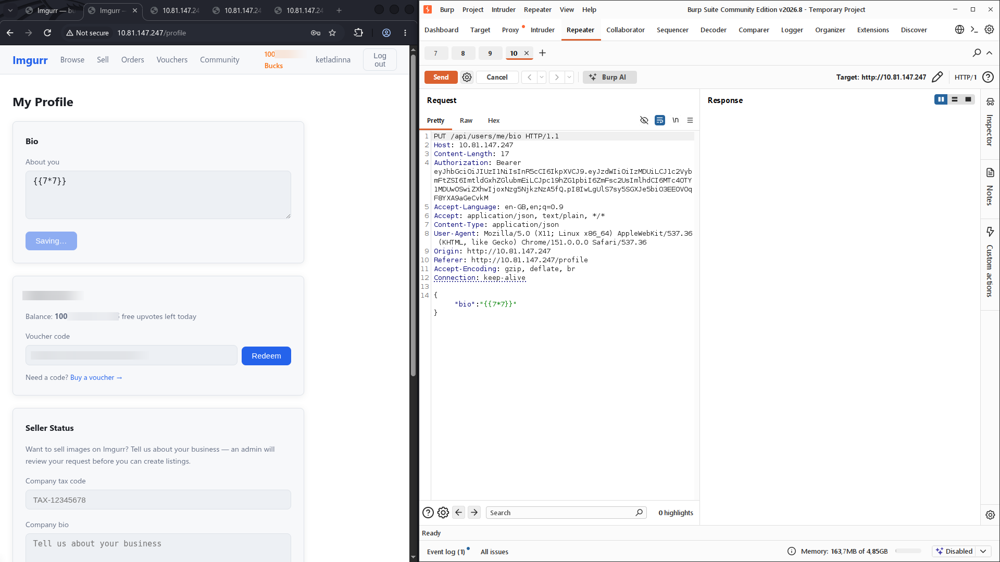

[← Back to overview](../README.md)

# Finding 11: Client-Side Template Injection (Profile Bio)

**Severity:** Medium
**CWE:** CWE-1336
**OWASP Top 10 (2021):** A03:2021

## Description

The profile bio functionality accepts template syntax as part of user-controlled input. During testing, the value `{{7*7}}` was accepted by `PUT /api/users/me/bio` and the application returned its confirmation marker, indicating that the bio field is associated with a client-side template injection condition.

The affected functionality is exposed through `PUT /api/users/me/bio`. Further testing is required to establish whether the supplied template expression is actually evaluated during profile rendering and whether the template context permits execution beyond simple expression evaluation.

This is more specifically classified as **CWE-1336 (Improper Neutralization of Special Elements Used in a Template Engine)** and falls under **OWASP A03:2021-Injection**.


## Reproduction Steps

1. Enable **Proxy → Intercept → Intercept is on** in Burp Suite. Submit any bio text through the normal profile edit form. The legitimate `PUT /api/users/me/bio` request is intercepted.

2. Modify the intercepted JSON body to:

```
      {"bio":"{{7*7}}"}
```

Forward the request and confirm that the application accepts the modified value.

3. Open **Proxy → HTTP history** and review the forwarded request and response. The response returns the application's confirmation marker. The API response also returns the submitted template expression as `{{7*7}}`. However, the affected profile does not display `49` when viewed in the browser, so template evaluation in the rendered profile could not be independently confirmed during this test.

4. Test the other free-text fields identified during enumeration using the same template expression. Each was confirmed to return and display the submitted expression without producing the confirmation marker, isolating the profile bio endpoint as the affected functionality identified during the assessment.

## Evidence


*__Figure 11.1__ - SS CSTI 01 confirmed.*

## Business Impact

The assessment confirmed that the application accepts attacker-controlled template syntax in the profile bio field and returns its confirmation marker. However, the submitted expression was not observed being evaluated in the rendered profile, and arbitrary script execution was not demonstrated. The impact of the template injection therefore cannot currently be confirmed beyond the identified injection point.

If the underlying template processing can be further abused to access browser-side objects or execute arbitrary JavaScript, the impact could increase significantly. This could potentially allow session or token theft, unauthorised actions in a victim's browser, or compromise of users who view the affected profile.

The profile bio is displayed on the user's profile page, so any further exploitable template behaviour could potentially affect users who view the profile. Further testing should be performed after reviewing the template rendering mechanism to determine whether the identified behaviour can be escalated beyond the current demonstrated condition.


## Remediation

Treat all user-supplied profile data as untrusted data and ensure that the profile bio cannot be interpreted as template syntax. The bio should be rendered strictly as inert text using the framework's standard text-binding or text-rendering mechanism, with appropriate escaping applied where required.

Templates should remain static and be defined only within the application's source code. User-controlled or stored values must never be incorporated into template definitions or passed to a template compiler. Review the profile rendering flow to determine where the submitted bio is processed and ensure that template expressions supplied by users are handled only as literal text.

The same controls should be applied to other locations where user-controlled values are rendered. This helps prevent similar template injection conditions from being introduced through other profile fields or application functionality.
