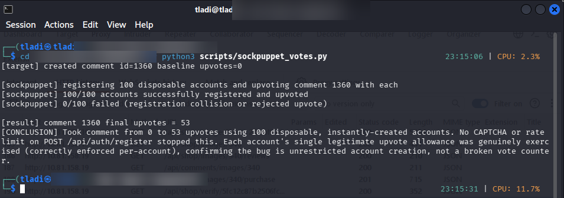

[← Back to overview](../README.md)

# Finding 12: Sockpuppet Vote Manipulation via Unrestricted Registration

**Severity:** Low
**CWE:** CWE-799, CWE-840
**OWASP Top 10 (2021):** A04:2021

## Description

The registration endpoint has no CAPTCHA and no meaningful rate limiting of any kind, so an attacker can mass-create disposable accounts in a matter of seconds. Each of those accounts is entitled to exactly one genuine upvote on the site's Community leaderboard of most-upvoted comments, a per-account limit that is otherwise correctly and atomically enforced on its own. Because that one-vote-per-account rule has nothing standing behind it to stop an attacker generating unlimited fresh accounts, it is trivially defeated at the account-creation layer entirely, rather than being broken at the voting endpoint itself.

The endpoint is `POST /api/auth/register`. This is **CWE-799 (Improper Control of Interaction Frequency)**, whose own MITRE description specifically cites a website that conducts a poll but only expects humans to vote once a day as the canonical example of exactly this bug, combined with **CWE-840 (Business Logic Errors)**, since the feature's underlying trust model assumes one account roughly corresponds to one genuine person and nothing on the platform actually enforces that assumption. It is classified under **OWASP A04:2021-Insecure Design**, alongside the other missing anti-automation controls identified elsewhere in this report.

## Reproduction Steps

Registering and upvoting through roughly 100 individual accounts by hand through the interface is not practical, and Burp Community's Intruder, while capable of scripted registration, has no equivalent built-in way to then fire 100 authenticated upvote requests, one per freshly issued token, in a single batch. This was instead reproduced with a short Python script using the `requests` library:

1. Register one account and post a fresh target comment on an image, noting its id and baseline upvote count of 0.

2. In a loop of 100 iterations, each one independently: register a new disposable account with a unique throwaway username and email, obtain its bearer token from the registration response, and immediately call `POST /api/comments/<id>/upvote` with that token against the target comment.

3. Run all 100 iterations concurrently (20 at a time) and record each registration and upvote response.

4. All 100 of 100 accounts registered and successfully upvoted (`200 OK`), with zero rejections from the registration endpoint, confirming no CAPTCHA or rate limit stood in the way. Re-fetching the comment afterwards showed its upvote count had risen from 0 to 53, a clean demonstration that unrestricted, disposable account creation alone was sufficient to inflate it, with no need to defeat the separately and correctly enforced per-account upvote limit.

## Evidence

*__Figure 12.1__ - SS F28 01 100 accounts upvote inflation.*

## Business Impact

This finding scores Medium on Integrity for the platform's own community features: the leaderboard exists to surface genuinely popular content, and its entire value as a trust signal depends on the assumption that one vote represents one real person's opinion. An attacker with no special access whatsoever, just a simple scripted registration loop, can inflate any comment's ranking arbitrarily, which could be used to promote spam, deliberately misleading content, or even a competitor's negative comment about a legitimate seller to the very top of a surface visible to, and trusted by, every visitor to the platform. Because account creation itself is the primitive being abused here, this finding also compounds every other finding in this report that depends on "an attacker needs an account" as any kind of limiting factor at all, for example Finding 17's file upload, which only requires an approved seller account, itself only one unauthenticated request away via Finding 16.

Unrestricted, unthrottled registration is, in that sense, a force multiplier for the rest of this report's findings, not merely a leaderboard-integrity issue confined to itself.

## Remediation

Add a CAPTCHA, or an equivalent proof-of-work challenge, to the registration endpoint, and rate-limit registrations by source IP address and by time window. Require email verification before a newly created account's votes, and any other similarly trust-weighted action, are allowed to count at all, so that a disposable, unverified account cannot immediately exercise the same privileges as one that has been genuinely established over time.
