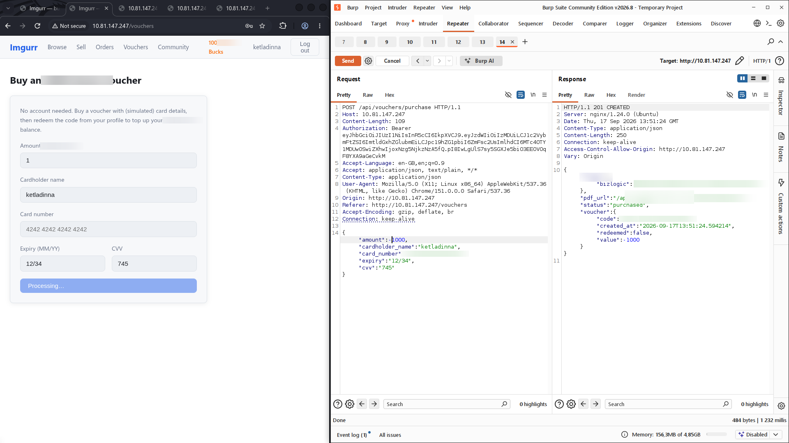

[← Back to overview](../README.md)

# Finding 13: Business Logic Flaw: Negative Voucher Amount

**Severity:** Medium
**CWE:** CWE-840, CWE-20
**OWASP Top 10 (2021):** A04:2021

## Description

The gift voucher purchase functionality accepts a negative value for the voucher amount and creates a voucher with that negative value instead of rejecting the request. A value of exactly zero is rejected, demonstrating that some amount validation is present, but negative values are not adequately restricted.

The affected endpoint is `POST /api/vouchers/purchase`. The endpoint also does not require authentication. The same purchase request succeeds both with and without an `Authorization` header, allowing an unauthenticated user to interact with the voucher functionality.

Additional testing of the same feature found that price tampering during a normal purchase is ignored by the server, insufficient funds are correctly rejected without creating a negative account balance, and non-integer amounts are rejected. The issue is therefore specifically related to the failure to enforce a valid lower bound on the voucher amount, combined with the lack of authentication on the purchase endpoint.

This is **CWE-840 (Business Logic Errors)**, with **CWE-20 (Improper Input Validation)** applying to the voucher amount validation. The missing authentication is separately classified as **CWE-306 (Missing Authentication for Critical Function)**. The primary classification is **OWASP A04:2021-Insecure Design**, with an **OWASP A01:2021-Broken Access Control** component for the unauthenticated endpoint.

## Reproduction Steps

1. **Enable Proxy → Intercept → Intercept is on in Burp Suite. Purchase a voucher through the normal purchase form. The legitimate `POST /api/vouchers/purchase` request is intercepted.**

2. **Remove the `Authorization` header entirely and modify the intercepted JSON body's `amount` value to `-500`. Keep the remaining valid purchase fields unchanged, then forward the request.**

3. **The server accepts the request and creates the voucher with the negative amount. This confirms that the endpoint does not require authentication and does not reject negative voucher amounts.**

4. **Repeat the purchase through the normal interface and modify the intercepted `amount` value to `0` before forwarding the request. The server correctly rejects the request. This confirms that amount validation is present but does not enforce a valid positive lower bound, isolating the negative-value case as the validation gap.**

## Evidence

*__Figure 13.1__ - SS BizLogic 01 confirmed.*

## Business Impact

Successful exploitation can corrupt the platform's financial records by allowing vouchers with negative monetary values to be created. This could distort voucher balances, transaction records, and the platform's internal accounting, potentially resulting in financial discrepancies and incorrect handling of stored value.

The endpoint requires no authentication, allowing an unauthenticated user to create a negative-value voucher without first obtaining an account or legitimate user session. This increases the accessibility of the vulnerability and makes automated exploitation possible.

If the voucher redemption functionality identified in Finding 15 processes negative-value vouchers in a way that affects another user's balance, the two vulnerabilities could potentially be chained to produce a more serious financial impact. This behaviour was not separately confirmed during testing and should therefore be investigated during remediation.

Successful exploitation could result in financial losses, corrupted transaction records, reconciliation issues, incident response and recovery costs, and reputational damage.

## Remediation

Validate the voucher amount server-side as a positive integer within a clearly defined and sensible range. Reject zero, negative values, non-integer values, and amounts outside the permitted range before creating the voucher. Client-side validation should be treated only as a usability control and must not be relied upon for security.

The server should calculate and validate the voucher value using trusted server-side data and ensure that subsequent balance or redemption operations cannot be manipulated through client-supplied monetary values.

Require authentication before allowing access to `POST /api/vouchers/purchase` and enforce the same server-side access-control checks consistently across the voucher functionality. The authentication weakness should be remediated alongside the amount-validation issue because the current endpoint can be reached without an account.
