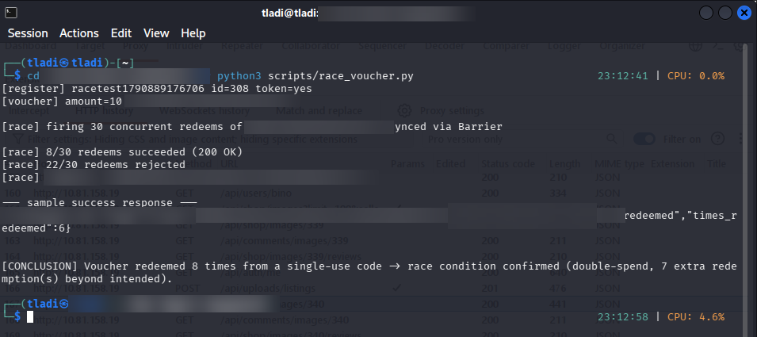

[← Back to overview](../README.md)

# Finding 15: Race Condition: Voucher Double-Redeem

**Severity:** Medium
**CWE:** CWE-362
**OWASP Top 10 (2021):** A04:2021

## Description

Redeeming a gift voucher is not an atomic operation on the server. If many redemption requests for the same voucher code arrive within the same narrow window of time, more than one of them can be credited before the server has finished writing the "already redeemed" state from the first, a classic time-of-check to time-of-use race condition. The endpoint is `POST /api/vouchers/redeem`.

The application confirms the double-spend in its response only when it genuinely occurs, not on a normal single redemption. This is **CWE-362 (Concurrent Execution using Shared Resource with Improper Synchronization)**, under **OWASP A04:2021-Insecure Design**.

## Reproduction Steps

Burp Community's Repeater has no built-in parallel group-send capability (that feature is Burp Suite Professional only), and manually duplicating and firing Repeater tabs by hand cannot reliably land simultaneous requests within the narrow window this race needs. This was instead reproduced with a short Python script using the `requests` library: an independent `requests.Session` per thread (a single shared session serialises its own connections and defeats the race entirely) combined with a `threading.Barrier`, so every thread's request is released at the exact same instant rather than merely "at roughly the same time."

1. Buy a voucher through the normal purchase form and note its code.

2. Register one throwaway account and obtain its bearer token.

3. Spawn 30 threads, each opening its own independent `requests.Session`, all waiting on a shared `threading.Barrier(30)`; once every thread has reached the barrier, it releases them all simultaneously, and each thread immediately fires `POST /api/vouchers/redeem` with the identical voucher code.

4. Count the responses: 8 of the 30 concurrent requests came back `200 OK` and "redeemed" for the identical single-use code, with the balance credited on each success; the responses confirm the double-spend. A plain, sequential resend of the same request, one after another rather than truly in parallel, was separately confirmed to never trigger this outcome, since each request completes and updates the stored state before the next one begins.

## Evidence

*__Figure 15.1__ - SS F12 01 concurrent redeem 8 of 30.*

## Business Impact

This finding scores Medium on Integrity for the platform's financial accuracy: an attacker can redeem a single voucher repeatedly, crediting balance to their own account more times than the voucher was genuinely worth, which is direct financial loss to the platform proportional to however many requests can successfully be raced through before the server catches up. In testing, firing 30 genuinely simultaneous requests against one voucher reliably produced 8 successful double-redemptions, which, scaled across many vouchers or a larger number of simultaneous requests per attempt, represents a real and repeatable path to financial loss rather than a one-off curiosity confined to a lab environment.

## Remediation

Make redemption a single, atomic database operation rather than a separate check followed by a separate update. A conditional update that flips the redeemed state to true in the same statement that checks its current value, for example `UPDATE vouchers SET redeemed = true WHERE code = ? AND redeemed = false`, or an explicit row lock held for the duration of the check-and-update, ensures only the very first concurrent request can ever succeed, with every other one observing the already-redeemed state rather than racing past it.
