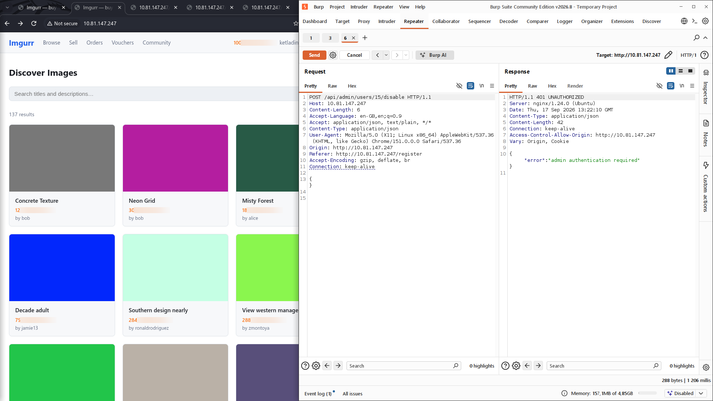

[← Back to overview](../README.md)

# Finding 16: Seller Approval Endpoint Requires No Authentication

**Severity:** High
**CWE:** CWE-306
**OWASP Top 10 (2021):** A01:2021

## Description

The application provides an administrator function for approving buyer applications to become sellers. The approval endpoint, `POST /api/admin/sellers/<id>/approve`, does not enforce authentication or authorisation before performing the approval action.

The issue was confirmed by sending the request without an `Authorization` header and without an authenticated session, targeting a genuine pending seller application belonging to another account. The application processed the request successfully, demonstrating that a completely unauthenticated user can approve pending seller applications by supplying the relevant account ID.

This is **CWE-306 (Missing Authentication for Critical Function)** and is classified under **OWASP A01:2021-Broken Access Control**. Other administrative functions on the same `/api/admin` surface were tested using the same approach and correctly required administrator authentication, confirming that the missing control is specific to this endpoint.

## Reproduction Steps

1. **Enable Proxy → Intercept in Burp Suite and register a throwaway account. Submit a seller application through the profile page and forward the genuine **

**`POST /api/users/me/seller-application` request so that the account has a pending application.**

2. **In Proxy → HTTP history, locate the `GET /api/auth/me` response and note the numeric user ID associated with the throwaway account.**

3. **Send a request to `POST /api/admin/sellers/<id>/approve` through Repeater, replacing `<id>` with the user ID obtained in the previous step. Remove the `Authorization` header and any session cookies so that the request contains no authentication credentials.**

4. **Send the request. The application returns a successful seller approval response.**

5. **Log in to the throwaway account and open the Sell page. The seller functionality is now available, confirming that the unauthenticated request performed the approval successfully.**

6. **As a control test, send unauthenticated requests to the administrative promote-user and unlock-account endpoints. Both reject the requests with `admin authentication required`, confirming that the missing authentication check is specific to the seller approval endpoint.**

## Evidence

*__Figure 16.1__ - SS AuthBypass 01 seller approve unauth.*

## Business Impact

Successful exploitation allows an unauthenticated attacker to approve pending seller applications belonging to other users, bypassing the intended administrative review process. This can result in unauthorised users gaining access to seller functionality and undermines the application's ability to control who is trusted with privileged functionality.

The impact becomes significantly more serious when combined with the unrestricted file-upload vulnerability identified elsewhere in the assessment. By obtaining seller status without authentication, an attacker can reach functionality that can be abused for server-side code execution without first compromising a legitimate seller account. This creates a practical attack path from an unauthenticated user to application server compromise.

Successful exploitation could therefore result in exposure of customer information, application credentials and secrets, unauthorised modification of application data, service disruption, incident response and recovery costs, and reputational damage. If personal information is compromised, the organisation may also have notification obligations under POPIA Section 22.

## Remediation

Require valid administrator authentication and authorisation before allowing `POST /api/admin/sellers/<id>/approve` to process any seller approval. The application should verify the user's administrator privileges server-side and reject unauthenticated or non-administrator requests.

Apply the same control centrally to all routes under `/api/admin` using shared middleware rather than implementing checks separately within individual handlers. Use a deny-by-default approach so that administrative routes cannot become publicly accessible because a developer forgets to add an authorisation check.

This finding and the unauthenticated administrator dashboard should be remediated and tested together, as both result from missing access controls on administrative routes.
