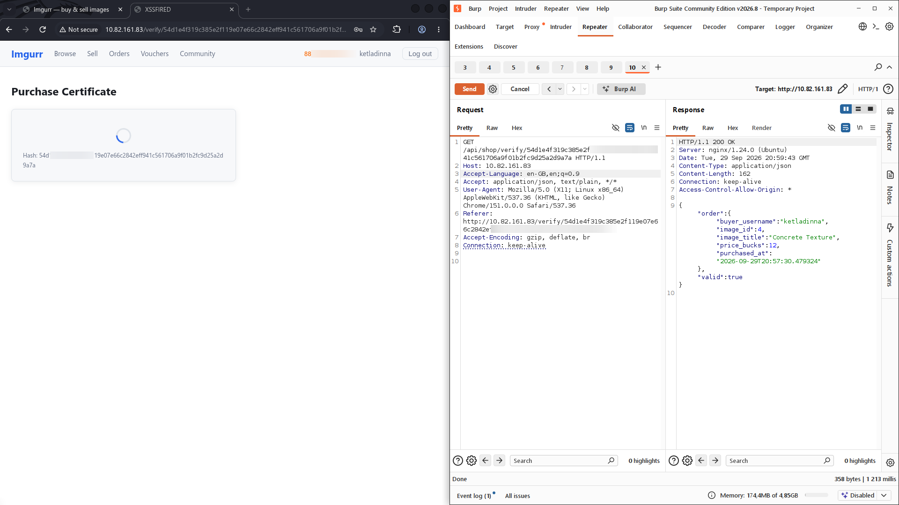

[← Back to overview](../README.md)

# Finding 18: Broken Access Control: Purchase Verification Without Authentication

**Severity:** Low
**CWE:** CWE-306, CWE-639
**OWASP Top 10 (2021):** A01:2021

## Description

A public order-verification endpoint returns full order details, including the buyer's own username, the item purchased, and the price paid, to anyone who supplies the correct verification hash, with no login required at all. The endpoint is `GET /api/shop/verify/<hash>`. This is best described as **CWE-306 (Missing Authentication for Critical Function)** with an IDOR-adjacent character, **CWE-639 (Authorization Bypass Through User-Controlled Key)**, since the hash itself is the sole access-control mechanism for a record that should additionally require the requester to actually be a party to the order; under **OWASP A01:2021-Broken Access Control**.

## Reproduction Steps

1. Buy any image normally through the application, then open **Orders** from the top navigation and find that purchase in the "My Purchases" list.

2. Click **View certificate** on that purchase. The certificate page loads and displays the verification hash both in the page itself and in the browser's address bar, as part of the URL `/verify/<hash>`.

3. In Burp's **HTTP history**, find the matching `GET /api/shop/verify/<hash>` request that fired when the page loaded. Right-click it and choose **Send to Repeater**.

4. In the Repeater request, delete the entire `Authorization: Bearer ...` header line, leaving every other header untouched, then click **Send**.

5. The response still returns `200 OK` with the full order object, buyer username, image title, price, purchase timestamp, and `"valid":true`, confirming the endpoint never actually checked for a credential at all.

## Evidence

*__Figure 18.1__ - SS F17 01 no auth header still returns order.*

## Business Impact

This finding scores Low to Medium on Confidentiality: purchase records leak who bought what and at what price, a privacy exposure of a customer's purchasing activity that could be used to build a profile of an individual's spending on the platform, or simply to confirm that a specific named person made a specific purchase, without needing to compromise their account in any way. Under POPIA this is unauthorised disclosure of personal information tied to a real financial transaction, which could create regulatory notification obligations if personal information were compromised in a real deployment.

## Remediation

Require authentication on this endpoint and confirm the requester is genuinely a party to the order, either the buyer or the seller, before returning any details at all. If the feature is instead intended to work as a public, anonymous receipt-verification tool, return only a minimal valid-or-invalid confirmation with no personally identifying fields attached to it.
