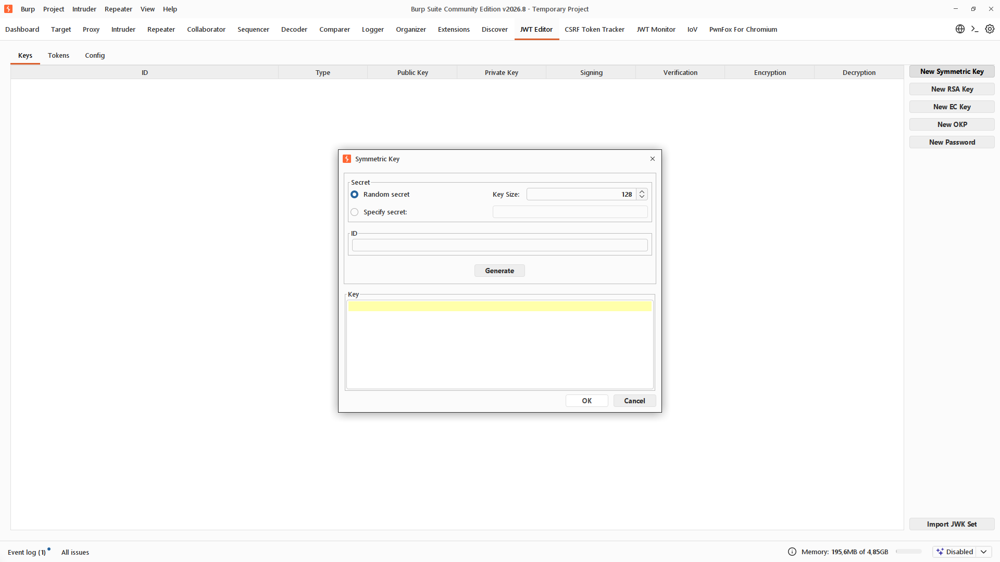
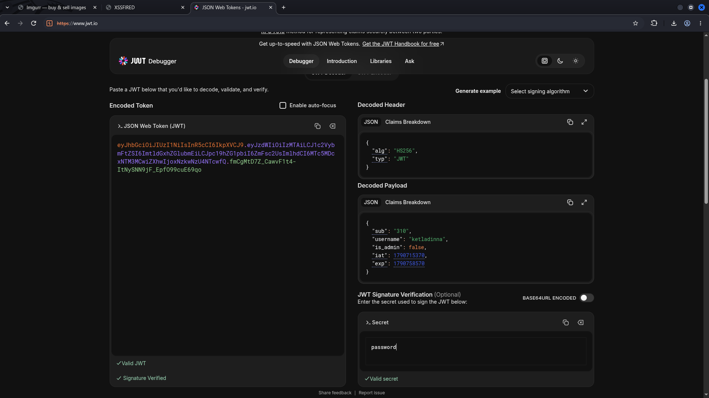

[← Back to overview](../README.md)

# Finding 20: Weak JWT Signing Secret

**Severity:** High
**CWE:** CWE-798, CWE-321
**OWASP Top 10 (2021):** A02:2021

## Description

Each authenticated user receives a token that the application uses to identify and authorise them on subsequent requests. The token is cryptographically signed using a secret key; however, the signing secret is the weak dictionary value `password`. The secret can be recovered from an issued token through an offline dictionary attack in a matter of seconds, allowing an attacker to generate valid tokens with modified identity or privilege claims, including administrator privileges.

This is **CWE-798 (Use of Hard-coded Credentials)** because the application relies on a predictable credential as its token-signing secret. Whether the value is hard-coded directly in the application source code or supplied through weak default configuration was not verified, so the finding is not additionally classified as **CWE-321 (Use of Hard-coded Cryptographic Key)**. The issue falls under **OWASP A02:2021-Cryptographic Failures**. This weakness is also the underlying cause of the privilege escalation demonstrated elsewhere in the assessment.

## Reproduction Steps

The vulnerability was reproduced primarily through the browser, with one command-line step used to perform the offline dictionary attack against the JWT.

1. Register an account and log in normally through the application. Capture the `access_token` returned in the login response.

2. Save the token to a file and perform an offline JWT dictionary attack using Hashcat:

```
       hashcat -m 16500 token.txt rockyou.txt
```

The signing secret was recovered as `password` within seconds.

3. Open **jwt.io** in a browser and paste the captured token into the **Encoded** panel. The **Decoded** panel displays the token header and payload, confirming that the token uses the `HS256` signing algorithm.

4. In the **Verify Signature** section, enter the recovered secret, `password`. The signature changes to **Signature Verified**, confirming that the recovered value is the actual signing secret used to sign the issued JWT.

5. Modify the JWT payload, changing the `is_admin` claim from `false` to `true`, and re-sign the token using the recovered secret.

6. Use the modified token in a request to an endpoint that relies on the JWT for authentication and compare the application's response with the original token.


## Evidence


*__Figure 20.1__ - SS JWTEditor 01 key setup.*


*__Figure 20.2__ - SS F03 02 jwtio signature verified password.*

## Business Impact

Successful exploitation could allow an attacker to impersonate users, access information or functionality available to the forged identity, and perform unauthorised actions under another user's account. This could result in customer data exposure, account compromise, financial or operational losses, and reputational damage.

The compromise of the signing secret also reduces confidence in application audit logs because actions performed using forged tokens may be attributed to another user's identity. This can increase the cost and complexity of incident response and forensic investigation. If personal information is compromised, the organisation may also have notification obligations under POPIA Section 22.


## Remediation

Replace the compromised JWT signing secret immediately with a long, cryptographically random value of at least 256 bits. Generate the secret using a cryptographically secure random generator and store it securely outside the application source code, preferably in a dedicated secrets manager or protected environment configuration. The secret must never be hard-coded, committed to source control, or included in application files that are accessible to unauthorised users.

Invalidate all tokens signed with the compromised secret and require affected users to authenticate again after the rotation. This is necessary because an attacker who has recovered the existing secret may continue creating valid tokens until the old signing key is no longer accepted.

HS256 may be retained provided that a strong, randomly generated secret is used and securely managed. Where multiple services need to verify tokens but should not be able to issue them, consider using an asymmetric signing algorithm such as ES256 or PS256 so that verification services only hold the public key while the private signing key remains restricted to the token issuer.

Review all application components that validate JWTs to ensure they use the new signing key and do not accept tokens signed with the compromised secret.
