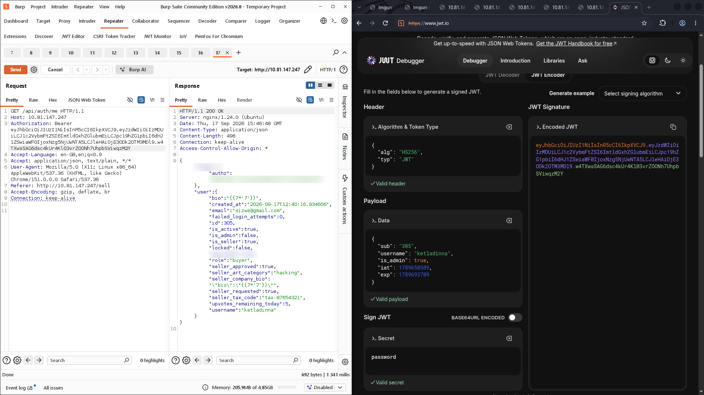
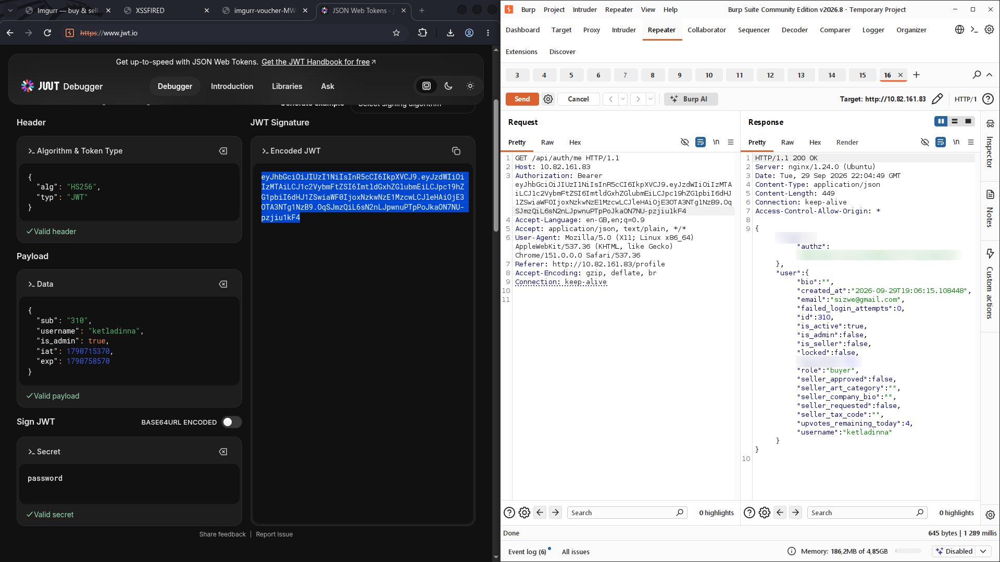

[← Back to overview](../README.md)

# Finding 21: Privilege Escalation via Forged JWT Claim After Signing-Key Compromise

**Severity:** High
**CWE:** CWE-863
**OWASP Top 10 (2021):** A01:2021

## Description

Signed JWTs are designed to carry authorization data such as role or privilege claims, and an application trusting those claims once a token's signature verifies is normal, intended behaviour, not a flaw in itself. The actual weakness demonstrated here is that Finding 20's compromised signing secret lets an attacker produce a token whose signature genuinely verifies while its claims are entirely attacker-controlled: any normal, genuinely registered, non-administrator user can mint a correctly and validly signed token for their own account that additionally claims administrator privilege, and the identity endpoint, `GET /api/auth/me`, honours that forged claim because it has no independent way to tell a forged-but-validly-signed token from a genuine one. This finding is entirely dependent on Finding 20; with a properly random signing secret, this specific attack is not possible.

This is **CWE-863 (Incorrect Authorization)**, since the server treats a successfully verified signature as sufficient proof of the privilege the token claims, under **OWASP A01:2021-Broken Access Control**. This was tested precisely to establish exactly what triggers it, since a first attempt using the real administrator's own account id rather than the tester's own did not succeed. The pattern that actually works is specifically self-escalation: your own genuine account id, with the administrator claim forged in alongside it.

Using a different account's id instead, including the real administrator's id, returns that other account's own data, itself a related information exposure since the signature check alone is enough to read any account's profile by id, but does not grant administrator rights, and a forged token for a non-existent id is correctly rejected outright. The vulnerability specifically is the server trusting a claim you make about your own privilege over its own stored record for your account, not a general ability to become any other named user on the platform.

## Reproduction Steps

1. Recover the signing secret `password` as described under Finding 20, and register a normal, non-administrator account. Note that account's own numeric user id, and capture the genuine `GET /api/auth/me` request the application makes after login, sending it to Repeater.

2. Open **jwt.io** in a browser tab and paste the current token from that Repeater request into the Encoded panel. In the decoded payload on the right, confirm the subject claim matches the account's own id noted above, then edit the payload directly in that panel to add `"is_admin": true` to the claim set.

3. In jwt.io's Verify Signature section, paste `password` into the secret field. jwt.io immediately re-encodes the header and the edited payload using that secret and displays the new, correctly and validly signed token in the Encoded panel on the left. Copy that new token.

4. Back in the Repeater tab, replace the `Authorization: Bearer` header's value with the newly forged token from jwt.io, and click **Send**. The response returns the account's own data, now additionally carrying administrator fields.

5. To confirm the precise trigger condition rather than assuming it, the same steps were repeated setting the subject claim in jwt.io to the real administrator's own id instead of the tester's own; the response returned the administrator's genuine data but no privilege escalation. A further attempt using a non-existent id was rejected outright with `401`, confirming the escalation is specific to self-escalation on one's own genuine account id, not general impersonation of another named user.

## Evidence

*__Figure 21.1__ - SS Authz 01 forged jwt.*

*__Figure 21.2__ - SS F25 02 forged jwt from scratch authz.*

## Business Impact

This finding scores High on Confidentiality and Integrity: any registered user can promote themselves to administrator on demand, purely by knowing the signing secret, with no interaction from a real administrator required at any point and no approval workflow of any kind to bypass, since the very check being bypassed is the only check that exists in the first place. This is a direct privilege escalation path from the lowest available privilege level, a freshly registered, entirely unvetted account, straight to the highest, at least as far as this particular endpoint reports it, achievable in well under a minute once the underlying secret is known, using nothing more than a browser and a common password wordlist.

## Remediation

Rotate the signing secret as described under Finding 20; this alone closes the specific attack demonstrated here, since it is the compromised secret that makes claim forgery possible in the first place. As defence in depth on top of that fix, treat any privilege claim carried in a token with the same caution appropriate to any piece of client-influenced data: verify the token's issuer, audience, and expiry on every request, and, for privileges that need to be revocable immediately or that change frequently, re-check the caller's current privilege against the database record rather than relying solely on what a token claims, which may have been issued some time ago and could be stale even when genuinely signed.
