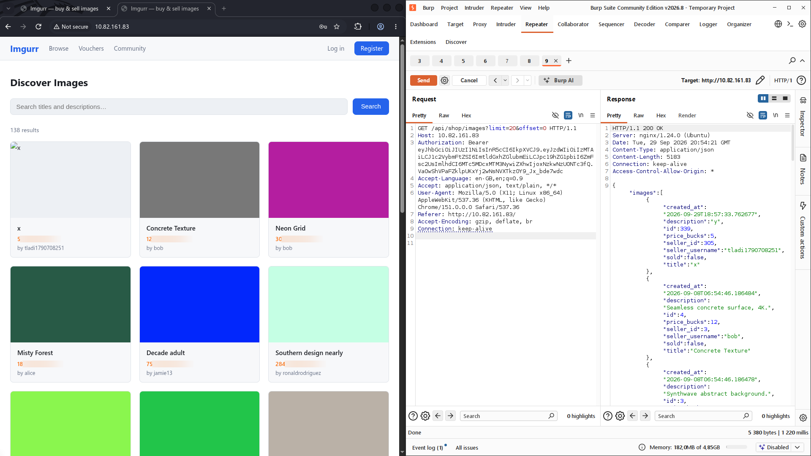

[← Back to overview](../README.md)

# Finding 22: No Session or Token Invalidation

**Severity:** Low
**CWE:** CWE-613
**OWASP Top 10 (2021):** A07:2021

## Description

There is no logout endpoint for user authentication tokens anywhere in the application, and every issued token remains fully valid until its own natural expiry, with no way for either the platform or the user themselves to revoke it early under any circumstance. This is **CWE-613 (Insufficient Session Expiration)**, under **OWASP A07:2021-Identification and Authentication Failures**.

## Reproduction Steps

1. Log in normally through the application and let any request that carries the `Authorization: Bearer` header appear in Burp's **HTTP history**. Right-click one, such as `GET /api/shop/images`, and choose **Send to Repeater**, then click **Send** once to confirm it currently returns `200 OK`.

2. Back in the application, click the **Log out** button in the top navigation. The page returns to a logged-out state as expected.

3. Return to the same Repeater tab, change nothing about the request at all, and click **Send** again.

4. The response is still `200 OK` with the identical data as before logging out. Requesting `POST /api/auth/logout` directly is also `404 Not Found`, confirming no server-side logout route exists at all; the "Log out" button only ever clears the token from the browser's own storage, and the token itself is never invalidated on the server.

## Evidence

*__Figure 22.1__ - SS F20 01 old token still works after logout.*

## Business Impact

This finding scores Low to Medium on Confidentiality: a stolen or leaked token, whether obtained through one of the cross-site scripting findings above, through a compromised device, or through any other exposure path entirely outside this assessment's scope, cannot be cut off by either the platform or the affected user. This meaningfully extends the window during which a stolen token can be misused well beyond the point a compromise is actually discovered: even after a user notices suspicious activity on their account and changes their password as a precaution, any token already issued to an attacker continues to work exactly as before until it naturally expires on its own, since password changes do not appear to invalidate any outstanding tokens on this platform.

## Remediation

Provide real token revocation, for example a server-side deny list keyed on each token's unique id claim and checked on every incoming request, keep token lifetimes short to limit the exposure window even in the absence of explicit revocation, and provide a genuine logout endpoint that adds the current token to that deny list rather than only clearing state on the client side, which currently achieves nothing from the server's point of view.
