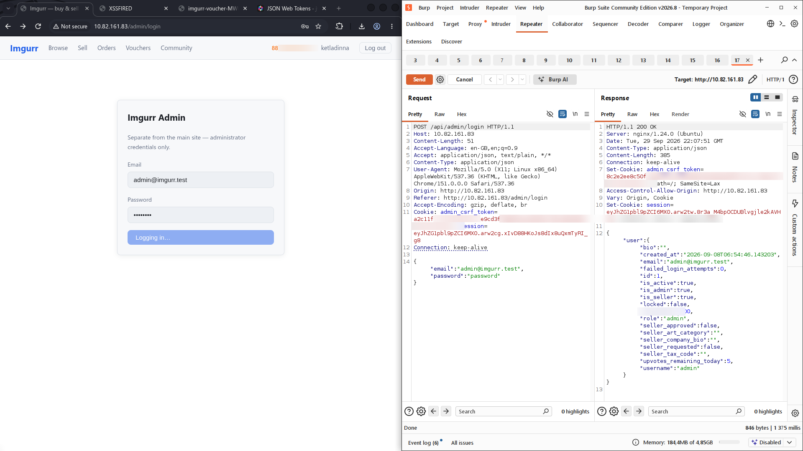

[← Back to overview](../README.md)

# Finding 23: Weak Administrator Password

**Severity:** High
**CWE:** CWE-521
**OWASP Top 10 (2021):** A07:2021

## Description

The platform's administrator account, `admin@imgurr.test`, uses the password `password`. This credential is trivially guessable and was successfully used to obtain a legitimate administrator session. The administrator login does not implement effective rate limiting or account lockout controls to prevent repeated password-guessing attempts, although these protections were not required to obtain access because the password was accepted immediately.

This is **CWE-521 (Weak Password Requirements)** and is classified under **OWASP A07:2021-Identification and Authentication Failures**. The compromised administrator credential provides a practical path to administrative functionality, including the command-injection and other administrator-only functionality identified elsewhere in the assessment. The finding therefore increases the practical exploitability and impact of vulnerabilities that rely on administrator authentication.

## Reproduction Steps

1. Navigate to the administrator login page and submit the administrator username `admin@imgurr.test` with the password `password`.

2. The login succeeds on the first attempt and establishes a valid administrator session, including the administrator session and CSRF protection cookies.

3. Access the administrator dashboard using the resulting session and confirm that administrator functionality is available.

## Evidence

*__Figure 23.1__ - SS F07 01 admin login with password succeeds.*

## Business Impact

This finding is rated High because compromise of the administrator credential provides access to privileged functionality with significant Confidentiality, Integrity and Availability impact. In particular, administrator access enables exploitation of the command injection identified in Finding 28 and the account takeover functionality identified in Finding 26.

The password `password` is trivially guessable and was accepted on the first authentication attempt, meaning an attacker does not need a sophisticated brute-force attack or extensive password-cracking effort to obtain administrator access. This significantly reduces the effectiveness of the administrator authentication control and makes the impact of other administrator-only vulnerabilities substantially more practical to achieve.

The compromised administrator account could therefore lead to server compromise, unauthorised account access, exposure or modification of customer information, service disruption, incident response and recovery costs, and reputational damage. If personal information is compromised, the organisation may also have notification obligations under POPIA Section 22.

Given its direct relationship with multiple High-risk attack paths, this credential should be remediated as an immediate priority.

## Remediation

Immediately replace the compromised administrator password with a long, unique, randomly generated credential. The existing credential should be considered compromised and must not be reused.

Enforce an appropriate password strength policy across all accounts, including the requirements identified in Finding 6. Protect the administrator login with rate limiting and account lockout or progressive delays to reduce the effectiveness of password-guessing attacks.

Multi-factor authentication should also be required for administrator accounts because of the elevated privileges associated with these accounts. Administrative credentials should be reviewed regularly and removed or rotated when compromise is suspected.

Mandatory periodic password changes should not be used as a substitute for these controls. Password resets should instead be triggered by evidence of compromise, suspected credential exposure, or other defined security events.
