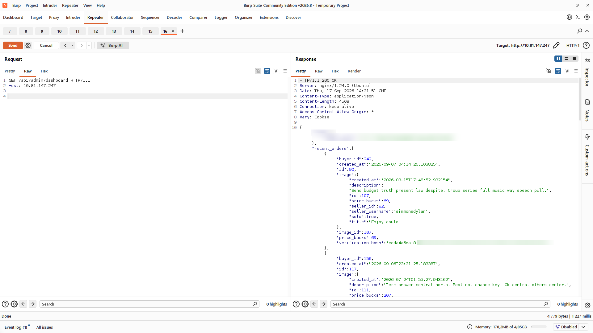

[← Back to overview](../README.md)

# Finding 24: Admin Dashboard Accessible With No Authentication

**Severity:** High
**CWE:** CWE-306
**OWASP Top 10 (2021):** A01:2021

## Description

The administrator dashboard is accessible to unauthenticated users without requiring a login, session, token, or other form of authentication. The affected endpoint is

`GET /api/admin/dashboard` and returns recent order activity across the platform.

The issue was confirmed by comparing requests with different authentication states. A request with no `Authorization` header, a request containing a validly signed token with administrator privileges, and a request containing a token without administrator privileges all returned the same complete dashboard response. This confirms that the endpoint does not perform an authentication check before returning administrator-level information.

This is **CWE-306 (Missing Authentication for Critical Function)** and is classified under **OWASP A01:2021-Broken Access Control**. The vulnerability is independent of the weak JWT signing secret identified elsewhere in the assessment; rotating that secret alone would not prevent unauthenticated access to this endpoint.

## Reproduction Steps

1. Open Burp Suite and use **Proxy** to capture a request to `GET /api/admin/dashboard`.

2. Send the request to **Repeater** and remove the `Authorization` header and any `Cookie` header so that the request contains no authentication credentials.

3. Send the request and observe that the application returns the full administrator dashboard, including recent order activity across the platform.

4. Repeat the request with a forged administrator token in the `Authorization` header and observe the same response.

5. Repeat the request again with a forged non-administrator token and observe that the response remains identical.

6. The endpoint therefore returns administrator-level dashboard data regardless of whether valid authentication credentials are supplied, confirming that authentication is not enforced on `GET /api/admin/dashboard`.

## Evidence

*__Figure 24.1__ - SS AdminPanel 01 confirmed.*

## Business Impact

Successful exploitation allows any unauthenticated party to access administrator-level order information across the platform, including data relating to customers and sellers. This creates a significant **Confidentiality** risk because sensitive business and customer information can be accessed without compromising an account or obtaining any credentials.

The exposure could result in customer privacy violations, misuse of order information, reputational damage, and incident response and recovery costs. Because the endpoint requires no authentication, the data could also be accessed repeatedly or at scale, increasing the potential volume of information exposed. If personal information is compromised, the organisation may also have notification obligations under **POPIA Section 22**.

## Remediation

Add authentication and authorisation checks to `GET /api/admin/dashboard` and require a valid administrator session before returning any dashboard data.

More importantly, apply these controls consistently across all routes under `/api/admin` using shared authentication and authorisation middleware rather than relying on individual route handlers to implement their own checks. This reduces the risk of additional administrative endpoints being exposed through the same oversight. Finding 16 should be addressed as part of the same remediation effort.

Adopt a deny-by-default access-control model across the application. Routes should be considered protected unless they are explicitly designated as public, and access decisions should be enforced server-side for every request.

The later assessment instance also exhibited a separate response-delivery issue on this route. This should be investigated independently, but it does not replace the required authentication and authorisation controls.
