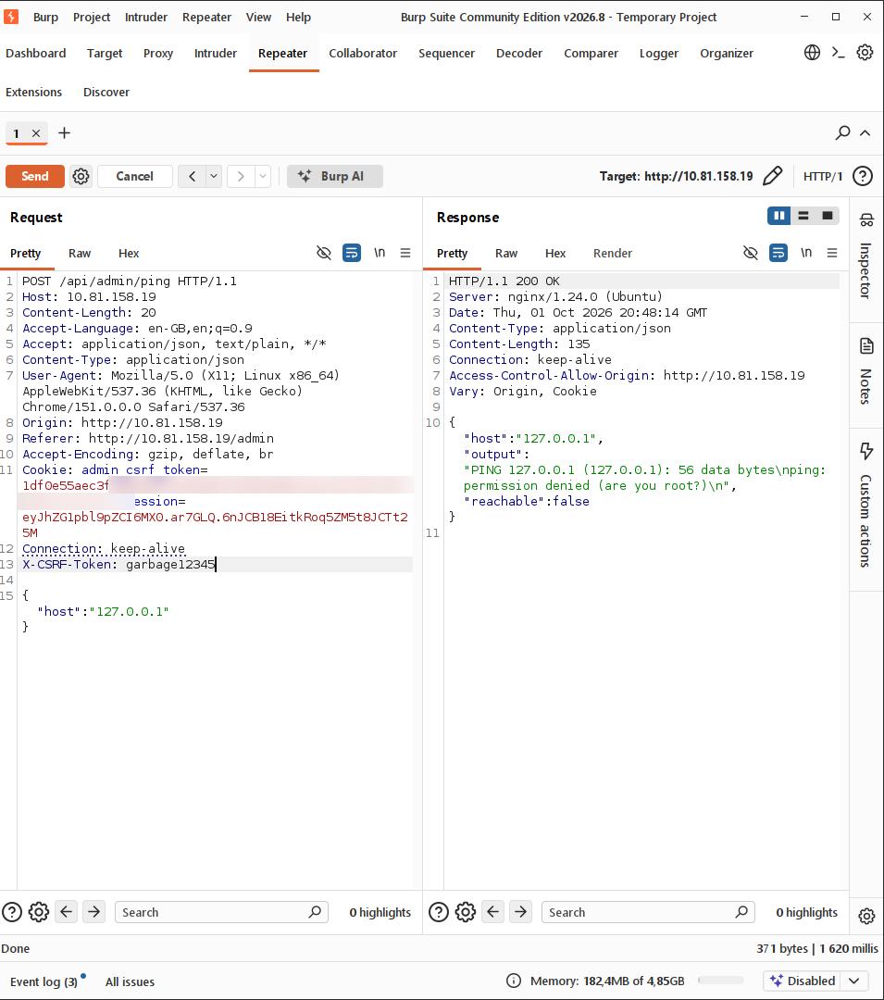

[← Back to overview](../README.md)

# Finding 25: CSRF Protection Checks the Cookie But Never Validates the Token

**Severity:** Low
**CWE:** CWE-352
**OWASP Top 10 (2021):** A01:2021

## Description

Logging in as administrator sets two separate cookies, one holding the session itself and a second intended as a cross-site request forgery token. The clear intent is a standard double-submit pattern: the client is expected to read the CSRF cookie's value and echo it back in a request header on every state-changing action, which the server should then compare against the cookie to confirm the request genuinely originated from the application itself. That comparison simply does not happen.

A request carrying the real session cookie and the real CSRF cookie succeeds identically whether the corresponding header is omitted entirely or set to a completely unrelated, wrong value; only the total absence of the CSRF cookie itself causes a rejection. This is **CWE-352 (Cross-Site Request Forgery)**, under **OWASP A01:2021-Broken Access Control**. The server is therefore only checking that the CSRF cookie exists, not that the value submitted in the header actually matches it, which means the protection is present in name only.

A genuine cross-site attacker cannot read or set the value of that cookie themselves, but a victim's browser attaches it automatically to any request reaching the application's own origin regardless, satisfying the "cookie is present" check while the header that was meant to prove the request's true origin is never actually verified at all. A real, working cross-origin proof of concept was built to test this directly, not merely reasoned about: an auto-submitting HTML form served from a genuinely different origin, targeting a state-changing admin route while a real admin session was live in the same browser. That attack failed, because both admin cookies are set with the `SameSite=Lax` attribute, which the browser itself correctly withholds from a cross-site POST request regardless of what the server-side check does or does not verify.

The CSRF token check is an ineffective control and a real quality flaw in its own right, but it is not independently exploitable through a classic cross-site request forgery attack today, specifically because `SameSite=Lax` is already doing the job the token check was meant to do.

## Reproduction Steps

1. Log in to the admin panel to obtain genuine session and CSRF cookies, then capture any state-changing administrative action, such as unlocking a user account, and send that request to Repeater.

2. Change the CSRF header's value to an obviously wrong string; the request still succeeds. Remove the header entirely instead; the request still succeeds identically. Remove only the CSRF cookie itself, leaving the session cookie and the (now irrelevant) header in place; this time the server correctly rejects the request, isolating precisely which of the two checks is genuinely functioning and which is not.

3. To test real-world exploitability rather than relying on the Repeater test alone, a small local HTML file was built containing an auto-submitting form that posts to the same admin route, served from a genuinely different local origin using a plain local web server. This was opened in a browser while the genuine admin session from step 1 was still live in that same browser. Burp's HTTP history was checked to see whether the forged request even reached the server with cookies attached; it did not, confirming `SameSite=Lax` blocks the cross-site delivery before the server-side check is ever reached at all.

## Evidence

*__Figure 25.1__ - SS F14 01 garbage csrf token still 200.*

## Business Impact

On its own today, this finding scores Low on Integrity, since it is not independently exploitable while `SameSite=Lax` remains in place. Its real significance is as a defence-in-depth gap combined with the rest of the admin surface: alongside the missing authorisation on the approve action (Finding 16) and the fact that a compromised admin session (Finding 26) receives no additional protection from a genuinely working CSRF check, this weakens the admin surface's resilience against any future change elsewhere in the codebase.

If the `SameSite` attribute were ever relaxed for an otherwise legitimate reason, for example to support embedding the admin panel inside a third-party integration, the ineffective CSRF check would provide no real protection at that point, and cross-site request forgery against the entire admin surface would become immediately exploitable with no further code change required anywhere on the attacker's side. Fixing this now, while it is a low-cost, low-risk change, avoids that scenario becoming a live High-severity issue later with no warning that it has quietly become exploitable.

## Remediation

Compare the submitted CSRF header value against the CSRF cookie's actual value on every state-changing request, and reject the request on any mismatch or on any absence of either the cookie or the header, not merely on the cookie's absence as it stands today. Keep session cookies at `SameSite=Lax` at minimum, or move to `SameSite=Strict` specifically for the admin session, accepting the small usability cost of losing cross-site navigation into an already-authenticated state, and verify the `Origin` and `Referer` headers on admin actions as a further, independent layer of defence that does not rely on cookie attributes alone.
