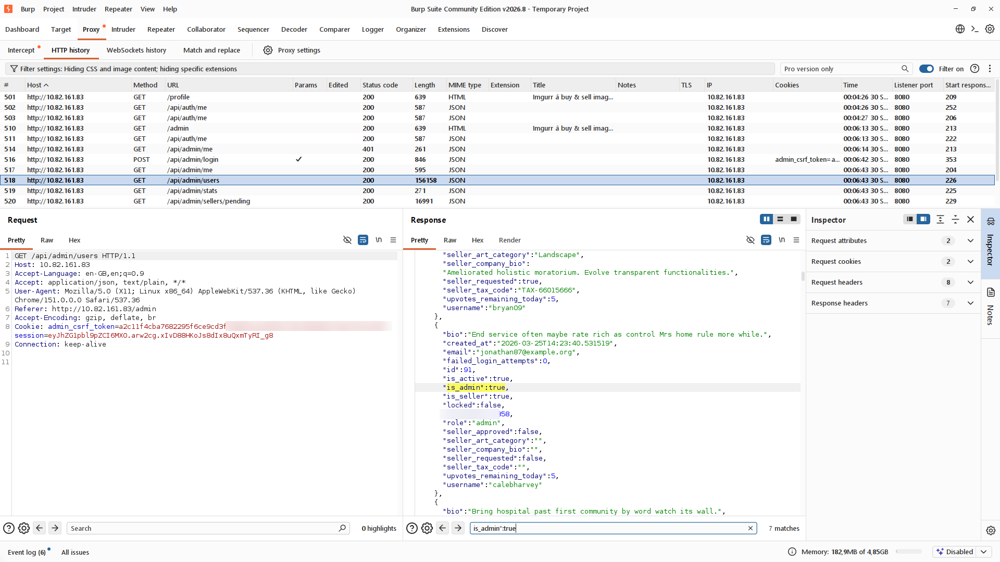
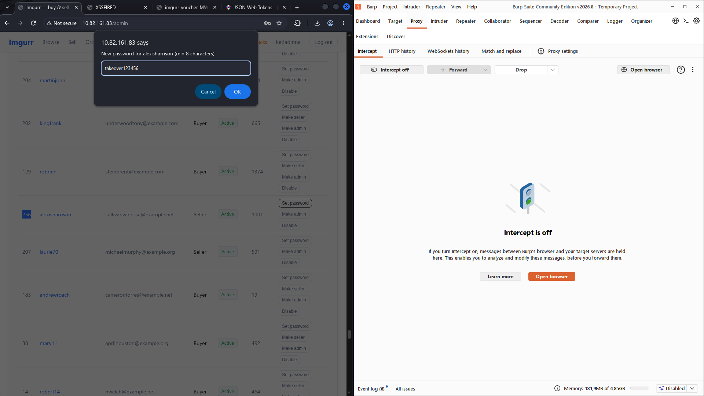

[← Back to overview](../README.md)

# Finding 26: Account Takeover via Administrative Password Reset

**Severity:** High
**CWE:** CWE-620
**OWASP Top 10 (2021):** A01:2021

## Description

The administrative endpoint that resets a user's password sets it to whatever value is supplied in the request body, with no verification of the account's current password, no reset token sent to the account owner, and no notification of any kind sent to them either. This gives whoever holds an administrator session a complete, silent takeover primitive for any account on the platform. The endpoint is `POST /api/admin/users/<id>/password`, and it sits behind the cookie-based admin session specifically, not the bearer token used elsewhere in the application; the forged JWT from Finding 21 was confirmed to be correctly rejected here, so the path into this finding is specifically the weak administrator password examined under Finding 23.

This is **CWE-620 (Unverified Password Change)**, under **OWASP A01:2021-Broken Access Control** with an **A07:2021-Identification and Authentication Failures** component. Once a genuine administrator session is obtained, this endpoint provides a full takeover primitive for any account whatsoever, including other administrators, and the ineffective CSRF check described under Finding 25 means that, in the specific scenario where `SameSite` protection were ever weakened for an unrelated reason, that same session could additionally be ridden cross-site.

## Reproduction Steps

1. Log into the administrator panel at `/admin/login` using the weak credential identified under Finding 23, then open the **Users** table further down the same page.

2. Pick any ordinary, non-administrator seller account at random from the several hundred listed, for example one with no relationship at all to any account already used elsewhere in this assessment, and click the **Set password** button in that row.

3. The browser's own prompt dialog asks for "New password for `<username>` (min 8 characters)." Type a freely chosen password and click **OK**. No challenge for the account's current password, no reset token, and no notification of any kind is presented at any point in this flow.

4. Log out, then log in again on the ordinary `/login` page using that account's real email address and the password just set in step 3. The login succeeds immediately and returns that account's own real token, balance, and order history, none of which the tester had any prior right to see.

5. The same steps were repeated once more against a second, different randomly selected account rather than reusing the same one, confirming the bug is general across the whole user base rather than specific to one particular seeded record.

## Evidence

*__Figure 26.1__ - SS F26 01 admin set password dialog alexisharrison.*

*__Figure 26.2__ - SS F26 02 logged in as kingfrank no consent.*

## Business Impact

This finding scores High on Confidentiality, Integrity, and Availability: any account on the platform, including other administrators, can be seized outright, giving the attacker the victim's balance, orders, listings, and whatever privileges that account itself carries, with the genuine account owner receiving no notification of any kind that their credentials were changed and therefore no opportunity to react until they themselves next attempt, and fail, to log in with their own original password. Combined with the other impersonation issues identified elsewhere in this report, no account on the platform can genuinely be considered under the sole control of its rightful owner once an attacker has reached the administrator session. An incident stemming from this finding, involving the seizure of real customer accounts and their associated data, could trigger the POPIA Section 22 notification obligations discussed under Finding 17, since it constitutes clear unauthorised access to personal account information by a party the platform never authorised.

## Remediation

Require the acting administrator to re-authenticate immediately before any sensitive account change of this kind, a step-up authentication prompt at the point of use rather than relying on a session established some time earlier. Issue password changes only through a one-time reset token delivered directly to the account owner's own registered email address, never as an administrator-supplied plaintext value set directly, notify the account owner by email of any reset regardless of who initiated it, and record the action in an audit log capturing the acting administrator's identity, the target account, and the timestamp of the change.
