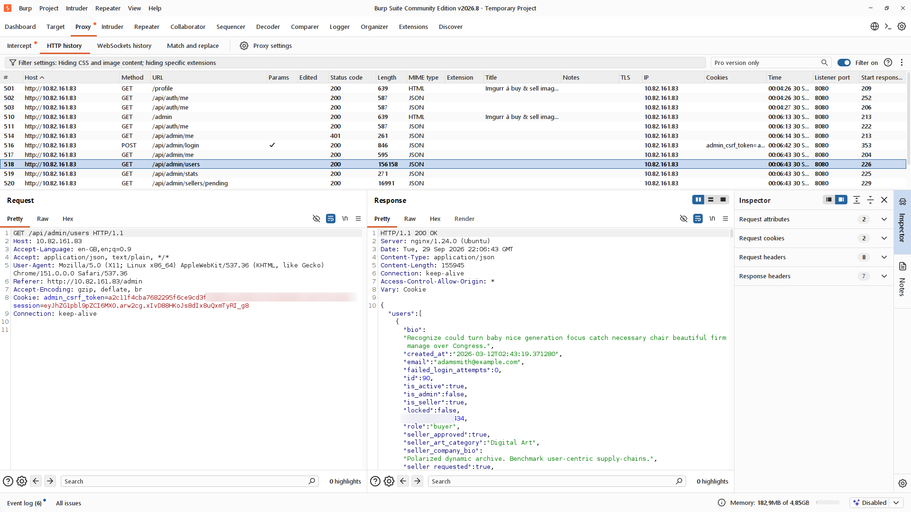

[← Back to overview](../README.md)

# Finding 27: Excessive Number of Administrator Accounts

**Severity:** Low
**CWE:** n/a
**OWASP Top 10 (2021):** A01:2021

## Description

The user store holds several accounts carrying administrator privilege beyond the single, documented administrator account this assessment otherwise focuses on, which breaches the principle of least privilege and widens the attack surface, since each additional privileged account is itself exposed to every weak-credential, impersonation, and takeover issue already described above. This is classified under **OWASP A01:2021-Broken Access Control**; no single CWE identifier maps cleanly to this finding, since the weakness is an account-provisioning and least-privilege practice rather than a specific coding defect.

## Reproduction Steps

1. Log into the administrator panel as described under Finding 23, then find `GET /api/admin/users` in Burp's **HTTP history**. Click it to select it, then open the **Response** tab, since the full listing returns several hundred seeded accounts in one JSON body, impractical to review by eye alone.

2. In the search box at the bottom of the Response panel, type `is_admin":true` and press Enter.

3. Burp reports **7 matches** and highlights each one directly in the response body. Scrolling to the first highlighted match shows a seeded account, `calebharvey` (id 91), carrying full administrator privilege, entirely separate from the one documented, primary administrator account.

4. Seven accounts in total carry administrator privilege on this instance, six of them beyond the single, documented administrator this assessment otherwise focuses on.

## Evidence

*__Figure 27.1__ - SS F27 01 seven is admin true matches.*

## Business Impact

This finding scores Low to Medium on Confidentiality and Integrity: a larger administrator population multiplies the number of distinct ways an attacker can gain administrative control, since any single weak or compromised account among a larger set is enough on its own, and a larger population of privileged accounts also means a correspondingly larger population whose credentials, if reused on another, unrelated service that later suffers its own breach, would grant administrative access on this platform through no fault of this platform's own controls at all.

## Remediation

Reduce the number of administrator accounts to the genuine minimum operationally required, and review the full privileged-account list on a regular, scheduled basis as part of a formal access recertification process, rather than allowing administrator status to accumulate silently over time.
